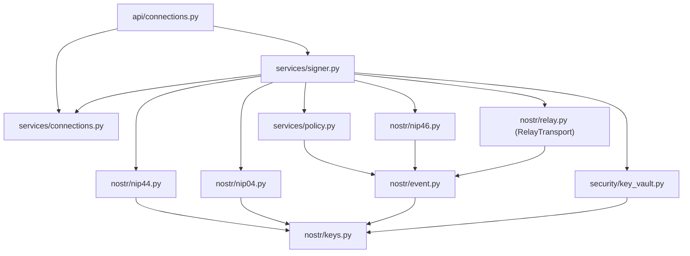

# Plan de implementación del firmante NIP-46

**Fase 0.3: diseño. No se implementó nada, no se instaló ninguna dependencia, no se conectó a relays ni a Stacker News.** Todo lo marcado **[D]** es una propuesta; ninguna está aprobada (ver `docs/decisions.md`).
Etiquetas: **[V]** verificado, **[I]** inferencia, **[H]** hipótesis pendiente, **[D]** decisión propuesta. Documentos relacionados: [nip46-protocol-analysis.md](nip46-protocol-analysis.md), [stacker-news-compatibility.md](stacker-news-compatibility.md), [nip46-security-design.md](nip46-security-design.md).

## 1. Qué hay que construir

Según la investigación, para autenticar una cuenta en Stacker News el firmante debe, como mínimo:

1. Generar y custodiar una clave de **identidad** y otra de **transporte** (claves de prueba).
2. Emitir una URI `bunker://` con relay `wss://` y secreto de un solo uso.
3. Mantener una suscripción a `kind 24133` dirigida a la clave de transporte, en uno o más relays.
4. Verificar la firma de cada evento recibido, **descifrar NIP-04 y NIP-44** y validar la solicitud.
5. Atender `connect`, `get_public_key` y `sign_event` (más respuestas mínimas a los demás métodos).
6. Autorizar al cliente y aplicar una política de firma restringida a `kind 27235`.
7. Responder con eventos `24133` firmados y cifrados, y publicarlos.
8. Exponer una API local para crear conexiones, aprobarlas, revocarlas y consultar estado.

No son necesarios para la primera demostración: `nostrconnect://`, login por NIP-05, SQLite completo ni interfaz web [I, §3 del documento de compatibilidad].

## 2. Evaluación de bibliotecas Python

Se pidió evaluar bibliotecas para Nostr, WebSockets, NIP-44, Schnorr/secp256k1 y validación de eventos. Datos de PyPI y GitHub consultados el 2026-11-20 **[V]**; **no se instaló nada**.

### 2.1 Primitivas criptográficas

| Opción | Versión (PyPI) | Licencia | Python y ruedas | Mantenimiento | Aporta | Límites |
|---|---|---|---|---|---|---|
| **`coincurve`** | 21.0.0 (2025-03-08) | MIT OR Apache-2.0 | `cp312` para Windows `win_amd64` y Linux `manylinux x86_64` **[V]** | Repo con push en 2026-08-12; 184 estrellas | Firma/verificación **Schnorr BIP-340** (`PrivateKey.sign_schnorr`, `PublicKeyXOnly.verify`), multiplicación de punto (`PublicKey.multiply`) para ECDH sin hash **[V, `keys.py` del repo]**, generación de claves. Envuelve libsecp256k1 | La última versión en PyPI tiene ~8 meses; `ecdh()` incluido **hashea** el resultado y **no debe usarse** para NIP-44 (hay que usar `multiply`) |
| `secp256k1` (rustyrussell) | 0.14.0 (2026-01-29) | MIT | **[H]** no se comprobaron ruedas para Windows | Repo con push en 2026-02-12 | Enlaces FFI a libsecp256k1 con Schnorr | Riesgo de compilación en Windows; menos probada que coincurve **[I]** |
| **`cryptography`** (PyCA) | 50.0.2 (2026-09-30) | Apache-2.0 OR BSD-3-Clause | Ruedas `abi3` para Windows y Linux **[V]**; dependencia `cffi` | Muy activo (push 2026-11-20; 7.8k estrellas) | **ChaCha20**, HKDF-expand, **AES-CBC** (NIP-04), AEAD (almacén cifrado), todo con primitivas auditadas | **No** ofrece Schnorr sobre secp256k1; HKDF-*extract* se obtiene con `hmac` de la biblioteca estándar (es HMAC) |
| `pycryptodome` | 4.5.0 (2026-11-15) | BSD-2 / Unlicense / MIT | Ruedas disponibles | Activo | ChaCha20, AES | Redundante con `cryptography`; duplicaría la superficie |
| Biblioteca estándar | — | PSF | — | — | `hashlib` (SHA-256), `hmac`, `secrets`, `base64`, `hmac.compare_digest` | No tiene ChaCha20, AES ni secp256k1 |

### 2.2 WebSockets

| Opción | Versión | Licencia | Dependencias | Observaciones |
|---|---|---|---|---|
| **`websockets`** | 17.4 (2026-10-30) | BSD-3-Clause | **Ninguna** **[V]** | Cliente `asyncio` maduro (5.7k estrellas, 1 issue abierto); requiere Python ≥ 3.11; ruedas `cp312` Windows y Linux **[V]**; reconexión con iterador asíncrono; encaja con FastAPI/`asyncio` |
| `aiohttp` | 3.14.5 | Apache-2.0 AND MIT | 9 dependencias declaradas (2 condicionales) | Más pesado; útil si ya se necesitara servidor HTTP asíncrono |
| `httpx-ws` | 0.10.0 | MIT | `httpx`, `anyio`, `wsproto`, `httpcore` | Capa fina sobre `httpx`; menor adopción **[I]** |
| `websocket-client` (usado por `python-nostr`) | — | — | — | API síncrona: bloquea el bucle de eventos; incompatible con `AGENTS.md` §5 |

### 2.3 Bibliotecas Nostr de alto nivel

| Opción | Versión | Licencia | NIP-46 | Dependencias y riesgos | Encaje |
|---|---|---|---|---|---|
| `nostr-sdk` (rust-nostr; repo `nostrdevkit/nostr-sdk-ffi`) | 0.45.2 (2026-11-14) | MIT (repo); metadatos de PyPI vacíos | Solo el **rol cliente**: expone `NostrConnect` y `NostrConnectUri.parse` **[V, `src/connect.rs` y `src/protocol/nips/nip46.rs`]**. **No** expone un firmante remoto | Binarios nativos (ruedas `abi3` de ~4 MB); cubre NIP-01/NIP-04/NIP-44 en Rust | No cubre el rol que necesitamos; fuerza una dependencia binaria grande y una API distinta a nuestra arquitectura |
| `pynostr` | 0.7.0 (2025-08-07) | MIT | **Sin NIP-44 ni NIP-46** por nombre de archivo en el repo **[V]**; `encrypted_dm.py` (NIP-04) | Dependencias: `coincurve`, `cryptography`, `tlv8`, `typer`, `tornado`, `rich`, `requests`; 12 issues abiertos | Aporta poco y añade dependencias pesadas |
| `python-nostr` (`nostr` en PyPI) | 0.0.2 (2023-01-26); repo con push 2024-08-14 | MIT | **Sin NIP-44 ni NIP-46** por nombre de archivo **[V]** | `secp256k1`, `websocket-client` (síncrono), 53 issues abiertos | Poco mantenida; descartada |

### 2.4 NIP-44 en Python

- No existe un paquete `nostr-nip44` en PyPI **[V]**, y el repositorio de referencia de NIP-44 (`paulmillr/nip44`) **no contiene archivos Python** (búsqueda por ruta) **[V]**; hay implementaciones en otros lenguajes y **vectores de prueba** oficiales.
- **Conclusión:** NIP-44 se implementa en el proyecto **componiendo primitivas de bibliotecas establecidas** (no criptografía propia): ECDH sin hash (`coincurve`), HKDF-extract (`hmac`), HKDF-expand y ChaCha20 (`cryptography`), HMAC-SHA256 y base64 (estándar). Se valida con `nip44.vectors.json` (checksum verificado) [V].

### 2.5 Recomendación **[D]**

| Necesidad | Elección propuesta | Justificación |
|---|---|---|
| Schnorr BIP-340, ECDH, claves | **`coincurve`** | Envuelve libsecp256k1; licencia permisiva; ruedas para nuestras plataformas; API para Schnorr verificada |
| ChaCha20, HKDF-expand, AES-CBC, AEAD del almacén | **`cryptography`** | Estándar de facto, auditable, activamente mantenida; ruedas `abi3` |
| WebSockets | **`websockets`** | Sin dependencias, asíncrona, activa |
| Validación | **Pydantic** (ya presente vía FastAPI) | Sin dependencia nueva |
| Eventos, NIP-01, NIP-04, NIP-44, NIP-46 | **Implementación propia en `app/nostr/`**, guiada por la spec y los vectores | No existe una biblioteca Python que implemente el rol de firmante NIP-46; las SDK evaluadas añaden más superficie de la que aportan |

**Dependencias nuevas que habría que aprobar (nada se instala hasta entonces)** y que, según `AGENTS.md` §8, requieren plan aprobado:

| Paquete | Propósito | Alternativa en biblioteca estándar | Licencia | Seguridad y mantenimiento |
|---|---|---|---|---|
| `coincurve` | Schnorr, ECDH, claves secp256k1 | Ninguna | MIT OR Apache-2.0 | Envuelve libsecp256k1; última versión de 2025-03 |
| `cryptography` | ChaCha20, HKDF, AES, AEAD | Ninguna | Apache-2.0 OR BSD-3-Clause | Muy activa (push el 2026-11-20); no se revisó su historial de avisos de seguridad **[H]** |
| `websockets` | Cliente WebSocket a relays | Ninguna práctica | BSD-3-Clause | Activa; sin dependencias |

Cada una arrastra transitivas (`cffi`, `pycparser`, etc.): al incorporarlas hay que **regenerar `constraints.txt`** (procedimiento del `README.md`) y revisar el diff.

### 2.6 Estrategia de validación criptográfica (revisión final)

#### Qué viene de bibliotecas y qué es lógica del protocolo

| Pieza | Origen | Detalle |
|---|---|---|
| Generación de claves, CSPRNG | `coincurve` (claves secp256k1 válidas) y `secrets` | Nada propio. |
| Firma y verificación **Schnorr BIP-340** | `coincurve` (`PrivateKey.sign_schnorr`, `PublicKeyXOnly.verify`) **[V, `keys.py` de coincurve]** | Nada propio. |
| Validación de claves públicas x-only | `coincurve`: `PublicKeyXOnly(...)` lanza `ValueError` si la clave no es válida **[V]** | Propio: comprobar formato (64 hex en minúsculas) antes. |
| Serialización NIP-01 y cálculo del `id` | **Lógica propia** + `hashlib.sha256` | Reglas de escape del `content` (análisis de protocolo §6.1). Es la parte con más riesgo de discrepancia con el cliente JavaScript **[I]**. |
| ECDH **sin hash** (coordenada X) | Primitiva `coincurve` `PublicKey.multiply` + **lógica propia** para elevar la clave x-only a punto (prefijo `0x02`) y extraer los 32 bytes de X | **No usar `PrivateKey.ecdh()`**: devuelve `sha256(clave pública comprimida)`, no X **[V, docstring en `keys.py:163-169`]**. NIP-44 y NIP-04 exigen X sin hash **[V]**. |
| HKDF-extract (`salt = "nip44-v2"`) | Biblioteca estándar `hmac` (extract es `HMAC(salt, IKM)`) | Código de unión propio, verificado con `valid.get_conversation_key`. |
| HKDF-expand (L = 76) | `cryptography` (`HKDFExpand`) o RFC 5869 con `hmac` | Elección en T3; ambas se validan con `valid.get_message_keys`. |
| ChaCha20 (RFC 8439, contador 0) | `cryptography` | La biblioteca recibe un nonce de 16 bytes (contador + nonce de 12). La adaptación es propia **[I, a confirmar con los vectores]**. |
| HMAC-SHA256 con AAD | `hmac` + lógica propia | La concatenación `nonce ‖ ciphertext` y su orden son propios. |
| Relleno (`calc_padded_len`, `pad`, `unpad`) | **Lógica propia** (pseudocódigo de la especificación) | `valid.calc_padded_len` (24 casos) e `invalid.decrypt`. |
| Formato de la carga (versión, `#`, longitudes mínimas, base64) | **Lógica propia** | `invalid.decrypt`. |
| Comparación del MAC | `hmac.compare_digest` | Tiempo constante **[V, NIP-44]**. |
| NIP-04 (AES-256-CBC, PKCS7) | `cryptography` + análisis propio de `"<base64>?iv=<base64>"` | Solo compatibilidad entrante. |

**Criptografía propia:** ninguna primitiva. Lo «propio» es la composición descrita por la especificación (protocolo), validada con vectores.

#### Vectores oficiales de NIP-44

Archivo `nip44.vectors.json` (checksum SHA-256 verificado contra el de la especificación **[V]**). Contenido **[V, inspección del archivo]**:

| Grupo | Casos | Qué valida |
|---|---|---|
| `valid.get_conversation_key` | 35 | ECDH sin hash + HKDF-extract |
| `valid.get_message_keys` | 1 clave de conversación y 32 juegos de claves | HKDF-expand y partición en `chacha_key`/`chacha_nonce`/`hmac_key` |
| `valid.calc_padded_len` | 24 | Cálculo del relleno |
| `valid.encrypt_decrypt` | 10 | Cifrado completo con nonce fijo y descifrado |
| `valid.encrypt_decrypt_long_msg` | 3 | Mensajes largos (por checksum) |
| `invalid.encrypt_msg_lengths` | 4 longitudes: 0, 65536, 100000 y 10000000 | Rechazo al cifrar |
| `invalid.get_conversation_key` | 8 (`sec1` ≥ n o 0; claves públicas fuera de la curva o puntos de la curva *twist*) | Rechazo de claves inválidas |
| `invalid.decrypt` | 12 (versión desconocida y versión 0; base64 inválido; MAC inválido ×2; relleno inválido ×3; longitud de carga inválida ×4) | Rechazo al descifrar |

**Cómo se usarán (Fase 1.0, tarea T3) [D]:**

1. Un solo conjunto de pruebas parametrizado con **todos** los casos válidos **y todos los inválidos**. Ningún caso se omite sin justificar por escrito.
2. Los casos de `encrypt_decrypt` usan un **nonce inyectado** (la firma de `encrypt` de la especificación recibe el nonce) para que el resultado sea determinista y comparable byte a byte; en producción el nonce siempre sale de un CSPRNG.
3. Los casos inválidos comprueban el **tipo de error de dominio** (`UnsupportedVersion`, `InvalidPayload`, `InvalidMac`, `InvalidPadding`, `InvalidKey`, `InvalidLength`), no solo «falló»; y que **no se devuelve texto plano parcial**.
4. Pruebas adicionales propias: ida y vuelta con claves aleatorias; alterar **cada byte** de la carga debe fallar; carga que supera el tope propio se rechaza **antes** de decodificar base64; simetría de la clave de conversación (`conv(a, B) == conv(b, A)`); *fuzzing* acotado en tiempo: cualquier cadena aleatoria solo puede producir errores de dominio.
5. La comparación en tiempo constante no puede probarse por temporización: se garantiza por diseño (`compare_digest`) y revisión.

**Discrepancia a resolver [V + decisión pendiente]:** el archivo de vectores marca como **inválidas** las longitudes 65536 en adelante, mientras que el texto vigente de NIP-44 (cambio del 2026-06-28) las **permite** con prefijo extendido y añade tres vectores solo por checksum (longitudes 65535, 65536 y 65537). El archivo de vectores no se actualizó desde 2024 **[V, `pushed_at` del repositorio]**. **[D]** Para el primer prototipo, límite de **65535 bytes de texto plano**. **Es una restricción provisional del prototipo, no una regla normativa universal:** la especificación vigente permite hasta 2^32 − 1 bytes. El límite es coherente con el archivo, con los mensajes de NIP-46 (muy pequeños) y, presumiblemente, con las bibliotecas JavaScript antiguas **[H: no se leyó `nostr-tools` 2.16.2]**. Los tres vectores por checksum se registran como **pendientes** hasta decidir soportar el prefijo extendido.

**Licencia del archivo de vectores [H]:** el repositorio `paulmillr/nip44` no declara licencia en la API de GitHub. Antes de copiar el archivo al repositorio hay que confirmar si puede redistribuirse; alternativa: pruebas que lo lean de una ruta local verificando su SHA-256 y que se omitan **de forma explícita y visible** si no está.

**Vectores BIP-340:** la verificación Schnorr se valida con los vectores oficiales de BIP-340 (`test-vectors.csv` del repositorio `bitcoin/bips`), **no descargados en esta fase**.

#### Estrategia de pruebas para NIP-04 heredado

NIP-04 **no publica vectores oficiales**: su especificación solo incluye un ejemplo de código **[V]**. Estrategia en capas **[D]**:

| Capa | Prueba | Qué cubre |
|---|---|---|
| 1. ECDH | La función de X sin hash se valida con NIP-44: `HKDF-extract(shared_x)` debe dar `valid.get_conversation_key`. NIP-04 reutiliza **la misma** función | Error clásico: usar un secreto hasheado |
| 2. Formato | Aceptar solo `"<base64>?iv=<base64>"` con IV de 16 bytes; rechazar sin `?iv=`, base64 inválido, IV de otra longitud, texto cifrado que no sea múltiplo de 16 | Entrada malformada |
| 3. Relleno | Rechazar PKCS7 inválido sin revelar el motivo hacia el exterior | Oráculo de relleno |
| 4. Propiedades | Ida y vuelta; clave equivocada falla; alterar IV o texto cifrado falla o produce error | Corrección básica |
| 5. Vectores de referencia **[D, requiere aprobación]** | Generar **una vez**, en el laboratorio NDK (T11), cifrados con `nostr-tools` usando claves de juguete, y guardarlos como *fixtures* | Interoperabilidad real con lo que produce el navegador |
| 6. Compatibilidad real | El primer `connect` de NDK 2.12.2, cifrado con NIP-04, debe descifrarse en el laboratorio (experimento E3) | La razón por la que existe el soporte |

Mientras no exista la capa 5, el soporte de NIP-04 se considera **no validado contra una implementación independiente**.

## 3. Arquitectura propuesta (revisión final)

### 3.1 Principios

- Respeta `AGENTS.md` §4: el código de protocolo **no importa FastAPI**; las dependencias fluyen hacia el dominio; ningún SQL fuera de `repositories`.
- **Mínima y sin especulación:** se crea un módulo solo cuando tiene una responsabilidad concreta en el **primer incremento**; una interfaz (Protocolo de Python) solo si hay **dos implementaciones reales** o hace falta aislar entrada/salida en las pruebas; sin módulos vacíos.
- **Primer incremento = en memoria.** Sin SQLite ni `repositories/`: el estado de conexiones y los ids vistos viven en memoria (con la limitación descrita en el diseño de seguridad §7). La persistencia se añade en T12.
- El nombre de la capa de configuración sigue **pendiente** (§3.5).

### 3.2 Módulos del primer incremento

| Módulo | Responsabilidad concreta | Depende de | Tarea |
|---|---|---|---|
| `app/nostr/keys.py` | `Keypair`: clave privada opaca; expone clave pública, firma Schnorr y ECDH sin hash; `__repr__` no muestra el secreto | `coincurve` | T2 |
| `app/nostr/event.py` | Evento Nostr: serialización NIP-01, `id`, firma y verificación, validación estricta de formato | `keys`, `hashlib` | T2 |
| `app/nostr/nip44.py` | Funciones `get_conversation_key`, `encrypt`, `decrypt` y errores de dominio | `keys`, `cryptography`, `hmac` | T3 |
| `app/nostr/nip04.py` | `decrypt` y `encrypt` heredados (solo compatibilidad) | `keys`, `cryptography` | T4 |
| `app/nostr/nip46.py` | Modelos Pydantic de solicitud y respuesta, constantes de métodos, construcción y análisis de `bunker://`. Sin E/S | `pydantic` | T5 |
| `app/nostr/relay.py` | **`RelayTransport`** (único Protocolo) y `WebsocketRelay`: suscripción, publicación, reconexión, NIP-42, tiempos acotados | `websockets`, `event` | T6 |
| `app/security/key_vault.py` | `KeyVault` concreto: genera claves de prueba y las guarda cifradas (AEAD, clave externa); devuelve `Keypair` | `nostr.keys`, `cryptography` | T7 |
| `app/services/connections.py` | Estados de conexión, secretos (hash, TTL, un solo uso), concesiones; registro en memoria | — | T8 |
| `app/services/policy.py` | `SigningPolicy`: funciones puras de permisos y de validación previa a firmar (diseño de seguridad §6) | `nostr.event` | T8 |
| `app/services/signer.py` | `SignerService`: valida el evento de transporte, descifra, aplica política, ejecuta el método, protege contra repeticiones y construye la respuesta | `nostr.*`, `connections`, `policy` | T9 |
| `app/api/connections.py` | Endpoints para crear, aprobar, rechazar, revocar y consultar conexiones. Solo validación y delegación | `services` | T10 |
| `app/main.py` (existente) | Tarea asíncrona del firmante dentro del `lifespan`, con arranque y parada controlados | `services`, `relay` | T10 |

Los dobles de prueba (relay falso en proceso, cliente que imita a NDK) viven en `tests/`, no en `app/`.

### 3.3 Interfaces: cuáles hacen falta en el primer incremento

La propuesta anterior listaba ocho interfaces. Tras la revisión:

| Interfaz propuesta antes | Decisión | Motivo |
|---|---|---|
| `RelayTransport` | **Se mantiene** (Protocolo) | Dos implementaciones reales desde el primer día: `WebsocketRelay` y un relay falso para pruebas deterministas sin red (`AGENTS.md` §6). |
| `Clock` | **Se elimina como interfaz** | Se inyecta una función `now: Callable[[], float]` donde haga falta. |
| `ConnectionStore` | **Se difiere** | Una sola implementación (memoria). Se extrae la interfaz cuando llegue SQLite (T12). |
| `AuthorizationPolicy` | **Se sustituye** por la clase concreta `SigningPolicy` | Una única política; sus funciones son puras y se prueban directamente. |
| `Cipher` | **Se elimina** | Funciones de módulo en `nip44` y `nip04`; no hay un segundo cifrador intercambiable. |
| `EventSigner` | **Se elimina** | `Keypair` concreto cubre firmar y obtener la clave pública. |
| `Nip46Dispatcher` | **Se integra** en `SignerService` | Un solo consumidor; una clase menos. |
| `KeyVault` | **Se mantiene como clase concreta** | Un Protocolo solo si aparece un segundo respaldo (por ejemplo, otro almacén). |

### 3.4 Diagrama de dependencias

Flechas = «depende de». Todo lo de `nostr/` es independiente de FastAPI, de `services/` y de `api/`.

### 3.5 Configuración: decisión `config/` frente a `core/` (sigue pendiente)

El primer incremento necesitará, como mínimo: URL(s) del relay, lista blanca de `u`, TTL del secreto, ventana de `created_at`, límite de tamaño y la variable con la clave de cifrado del almacén. **Esa necesidad real aparece en T1**, que es donde se decide el nombre y se crea el módulo. Hasta entonces **no se crea ningún módulo de configuración** y la decisión D8 permanece pendiente, como pidió el propietario.

### 3.6 Persistencia futura

SQLite detrás de una interfaz `ConnectionStore` extraída en T12 y de un repositorio de auditoría. El esquema y la migración se registrarán en `docs/decisions.md` **antes** de implementarlos y requieren aprobación.

## 4. Estrategia mínima de relays para la primera prueba

Requisitos **[D]**, derivados de los hallazgos:

1. **URL `wss://`**: la CSP de Stacker News impide `ws://` en producción [V] y el navegador del usuario es quien se conecta [V].
2. **Alcanzable desde el navegador del usuario y desde nuestro firmante.** Un relay local `ws://localhost` queda descartado para la prueba real [V, CSP]; para laboratorio sí sirve (ver §6.0).
3. Acepta `kind 24133` y eventos efímeros sin requerir pago ni lista blanca.
4. Si exige NIP-42, nuestro cliente debe implementarlo; NDK ya lo soporta [V].
5. **Un solo relay principal** para la primera prueba (menos variables); un segundo de reserva documentado.
6. Los candidatos se **eligen y verifican con autorización de conexión** (esta fase no conecta). **[H]** Ningún relay concreto está verificado. La lista de relays que Stacker News usa para *crossposting* (`lib/nostr.js:9-15`: `nostrue.com`, `relay.damus.io`, `relay.nostr.band`, `relay.snort.social`, `relay.primal.net`) **no es evidencia** de que sirvan para NIP-46 [I].

Comportamiento del cliente de relay **[D]**:

| Tema | Propuesta |
|---|---|
| Conexión | Una conexión por relay, reutilizada; `open_timeout` y `close_timeout` acotados |
| Suscripción | `{"kinds":[24133], "#p":[transport-pubkey], "since": ahora − margen}`; se vuelve a suscribir tras cada reconexión |
| Publicación | Esperar `OK`; reintentos acotados con *backoff* exponencial con tope; respetar `rate-limited` con su espera en ms [V]; tratar `mute:` como «nadie escuchaba» [V] |
| Reconexión | Reintentos con *backoff* y *jitter*; tras N fallos, estado degradado visible en el endpoint de salud (sin datos sensibles) |
| Duplicados | Descartar ids ya vistos (compartido con la protección contra repetición) |
| Tiempos | Todos los tiempos de espera acotados (`AGENTS.md` §5) |
| Interrupciones | Cierre ordenado en `lifespan`; si el relay cae mientras hay una aprobación pendiente, la solicitud sigue válida hasta su caducidad |
| Registro | Sin contenido de eventos; solo conteos y estados |

## 5. Plan de implementación por tareas

> Orden propuesto. **Ninguna tarea comienza sin autorización explícita de la fase correspondiente.** Cada una incluye sus pruebas pytest, sin red ni relays reales (relay falso en proceso), con **vectores oficiales** donde existan (`AGENTS.md` §6). Los módulos son los de §3.2.

| # | Tarea | Resultado y criterio de aceptación | Depende de |
|---|---|---|---|
| T0 | Aprobar dependencias, decisiones pendientes (incluida la licencia del archivo de vectores) y el esquema de cifrado en reposo | Decisiones registradas como aprobadas; `constraints.txt` actualizado al incorporar los paquetes | — |
| T1 | Configuración (**aquí se resuelve `config/` frente a `core/`**) | Variables validadas en un único punto; falla al arrancar si falta una obligatoria; `.env.example` sincronizado | T0 |
| T2 | `nostr/keys` y `nostr/event` | Pasa los vectores BIP-340; serializador NIP-01 con casos límite de escape; claves públicas inválidas rechazadas | T0 |
| T3 | `nostr/nip44` | **Pasa todos los casos válidos e inválidos** de `nip44.vectors.json` (§2.6), con el tope de 65535 bytes y los tres vectores por checksum registrados como pendientes | T2 |
| T4 | `nostr/nip04` (solo compatibilidad entrante) | Capas 1 a 4 de la estrategia de §2.6; capa 5 y 6 en T11 | T2 |
| T5 | `nostr/nip46` | Modelos estrictos; rechazo de método desconocido con error; URI `bunker://` con `relay` obligatorio | T2, T3 |
| T6 | `nostr/relay` | Pruebas contra un relay falso: suscribir, publicar, `OK`/`CLOSED`/`AUTH`, caída y reconexión, tiempos acotados | T2 |
| T7 | `security/key_vault` y generador de claves de prueba | AEAD con clave externa; nunca imprime privadas; no arranca sin clave de cifrado | T0, T2 |
| T8 | `services/connections` y `services/policy` (memoria) | Estados del diseño de seguridad §5.1; secreto de un solo uso; concesión de un solo uso para `27235`; validación previa a firmar (§6.1 del diseño) | T5, T7 |
| T9 | `services/signer` | Pruebas de extremo a extremo en proceso con un **cliente doble que imita a NDK** (NIP-04 inicial, `connect ["",secret]`, `ack`, `sign_event` con evento crudo); control de repetición | T3 a T8 |
| T10 | `api/connections` y `lifespan` | Autorización en cada endpoint; errores genéricos; la URI solo se devuelve una vez | T8, T9 |
| T11 | **Laboratorio de compatibilidad con NDK 2.12.2** (experimentos E1 a E3 del documento de compatibilidad) | Resuelve la incertidumbre NIP-04/NIP-44 **antes** de tocar Stacker News. Requiere aprobar la ejecución de código de terceros y herramientas de desarrollo (Node y un relay local) | T9 |
| T12 | SQLite: extraer `ConnectionStore`, ids vistos y auditoría | Esquema aprobado y registrado; consultas parametrizadas | T8 |
| T13 | **Prueba real con Stacker News** (§6) | Evidencia de nivel «login completo» | T9 a T11 y autorización de integración |

Cada tarea cierra con `pytest`, `git diff --check`, documentación al día y registro de IA, como las fases anteriores.

## 6. Procedimiento de prueba real con Stacker News

**No se ejecuta en esta fase.** Requiere una **autorización de sesión de pruebas** del propietario con alcance definido (`AGENTS.md` §11).

### 6.0 Prevalidación sin Stacker News (recomendada)

Antes de la prueba real, T9 y T11 deben pasar en laboratorio: cliente doble de NDK y NDK 2.12.2 real contra un relay **local**. Así se resuelven H2 y los errores de serialización sin exponer una cuenta.

### 6.1 Autorización requerida (plantilla)

| Punto exigido por `AGENTS.md` §11 | A completar por el propietario |
|---|---|
| Servicio externo y relays | Stacker News (`https://stacker.news`) y el relay primario (y de reserva) elegidos |
| Identidad o cuenta **de prueba** | Identidad Nostr generada para la prueba y cuenta nueva de Stacker News creada por el login; **nunca** una cuenta personal |
| Operaciones permitidas | Conectar el firmante al relay; login por `bunker://`; firma de un evento `kind 27235`; cerrar sesión |
| Duración y límites | Por ejemplo, una ventana de 60 minutos y un máximo de N intentos de login |
| Restricciones | Sin publicar contenido en Stacker News; sin otras firmas; sin otros relays; sin claves reales; evidencia redactada |

### 6.2 Pasos

| # | Paso | Quién |
|---|---|---|
| 1 | Generar la identidad de prueba y la clave de transporte con el comando del firmante; guardar la clave de cifrado del almacén fuera del repositorio. Anotar solo la `npub`. | Operador + agente |
| 2 | Arrancar el firmante (Docker Compose) en la máquina del operador. | Operador |
| 3 | Comprobar la conexión al relay: suscripción `REQ` y `EOSE` recibidos. | Agente |
| 4 | Crear la conexión: obtener la URI `bunker://` (se muestra **una sola vez**; no se guarda ni se registra). | Operador |
| 5 | Abrir `https://stacker.news/login?type=nostr` y pegar la URI. | **Humano** |
| 6 | Cuando llegue `connect`, el firmante lo deja en Pendiente; **aprobar** explícitamente con permisos `sign_event:27235`. | **Humano** |
| 7 | El firmante atiende `connect` (`ack`), `get_public_key` y `sign_event` (política de `27235`). | Firmante |
| 8 | Observar en la interfaz de Stacker News que el login se completa. | **Humano** |
| 9 | Registrar la evidencia (§6.3) sin exponer secretos. | Agente + operador |
| 10 | Cerrar: revocar la conexión, borrar la clave de cliente, retirar o dar de baja la cuenta de prueba si procede, y destruir la identidad de prueba. | Operador |

Pasos que **no pueden automatizarse**: 5, 6 y 8 (intervención humana y navegador). Pasos que dependen de terceros: disponibilidad del relay y de Stacker News.

### 6.3 Qué evidencia demuestra el login y cuál es solo parcial

| Nivel | Evidencia | ¿Demuestra login? |
|---|---|---|
| **Parcial A** | Firmante suscrito al relay (`REQ`/`EOSE`) | **No** (solo conectividad) |
| **Parcial B** | Llega un `connect` cifrado y se descifra | **No** (el cliente alcanzó al firmante) |
| **Parcial C** | `ack` publicado con `OK true` del relay | **No** |
| **Parcial D** | `get_public_key` respondido | **No** |
| **Parcial E** | `sign_event` firmado y publicado; la firma **verifica sin conexión** con la clave pública de identidad | **No**: demuestra la criptografía, no que Stacker News lo acepte |
| **Login completo** | Tras el paso 7, la interfaz de Stacker News muestra la sesión iniciada **y** el usuario creado corresponde a la identidad de prueba: según el código leído, una cuenta nueva se llama con los **10 primeros caracteres hex de la clave pública** (V6) **[H hasta verlo]**, y la sesión persiste al recargar | **Sí** |
| **Reproducibilidad** | Un segundo login (otro `k1`) funciona tras cerrar sesión | Refuerza el resultado |

Registro de la evidencia (en `docs/` al cierre, redactada): fecha y hora UTC, commit de Stacker News y de nuestro firmante, relays usados, secuencia de métodos con resultados (permitido/denegado), identificador truncado del evento firmado, resultado de la verificación Schnorr sin conexión, y una **captura redactada** de la sesión. **No** se guardan: la URI `bunker://`, claves privadas, cookies, tokens ni contenido descifrado.

### 6.4 Riesgos de la prueba real

| Riesgo | Prioridad | Mitigación |
|---|---|---|
| NDK no adopta NIP-44 tras nuestra respuesta (H2) | Alta | Prevalidar con T11; contingencia: modo «espejar» NIP-04 |
| El relay rechaza/limita `24133` o exige NIP-42 | Media | Elegir y verificar el relay con anterioridad; NIP-42 en T6 |
| Stacker News en producción difiere de `master` (H1) | Media | Observar el comportamiento en la primera conexión; repetir la lectura de código |
| Desfase de reloj o aprobación lenta | Baja | Ventanas configurables; el cliente no tiene timeout |
| La cuenta de prueba queda creada en Stacker News | Baja | Es esperable por V6; documentarlo y retirarla si procede |

## 7. Decisiones pendientes y preguntas para el propietario

| # | Decisión / pregunta | Prioridad | Recomendación |
|---|---|---|---|
| Q1 | ¿Se aprueba priorizar `bunker://` y dejar `nostrconnect://` para más adelante? | Alta | Sí |
| Q2 | ¿Se aprueba aceptar NIP-04 entrante de forma acotada y responder en NIP-44? | Alta | Sí, con contingencia «espejar» |
| Q3 | ¿Se aprueban `coincurve`, `cryptography` y `websockets` y la implementación propia de NIP-44 con vectores? | Alta | Sí |
| Q4 | ¿Se aprueba un laboratorio NDK (Node + relay local) como herramienta de desarrollo (T11)? | Media | Sí, antes de la prueba real |
| Q5 | Mecanismo de aprobación humana (comando, API o `auth_url`) | Media | API local; `auth_url` como mejora |
| Q6 | Resolver `config/` frente a `core/` | Baja | Decidir en T1 |
| Q7 | ¿Alternativa B de bloqueo con hashes antes de manejar claves? | Media | Evaluarla en T0 |
| Q8 | Relay primario y de reserva, y la ventana de autorización de la prueba real | Media | Elegir en T13 con autorización |
| Q9 | Esquema de cifrado en reposo y origen de la clave de cifrado | Alta | AEAD con clave externa por variable de entorno (detalle en `docs/decisions.md` antes de T7) |
| Q10 | Tope de 65535 bytes de texto plano en NIP-44 y vectores del prefijo extendido pendientes (P-14) | Media | Aprobar el tope para el primer prototipo |
| Q11 | Licencia y tratamiento del archivo `nip44.vectors.json` (P-16) | Media | Confirmar la licencia antes de copiarlo; si no, lectura local con SHA-256 verificado |
| Q12 | ¿Se aprueba la ejecución de código de terceros (NDK 2.12.2, `nostr-tools` 2.16.2) en el laboratorio, con los hashes del lockfile de Stacker News (T11, P-17)? | Alta | Sí, solo en laboratorio y con claves de juguete |
