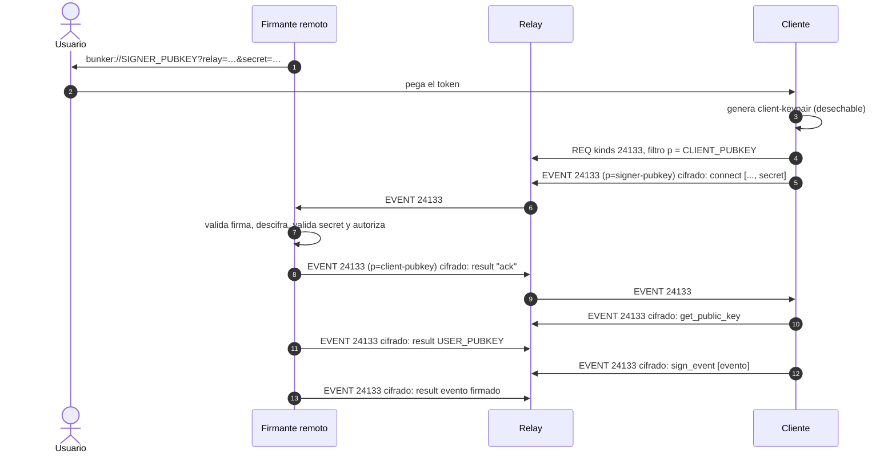
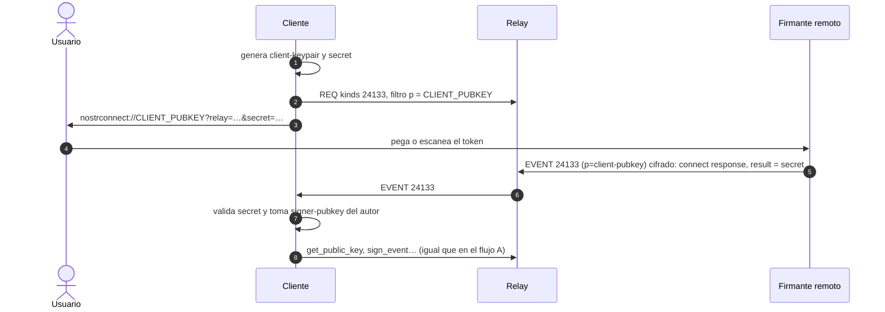

# Análisis del protocolo NIP-46 (y NIP relacionados)

**Fase 0.3: investigación y diseño. Documento de análisis; no hay implementación.**
Fecha de consulta: **2026-11-20 (UTC)**. Ver también [stacker-news-compatibility.md](stacker-news-compatibility.md), [nip46-security-design.md](nip46-security-design.md) y [nip46-implementation-plan.md](nip46-implementation-plan.md).

## 0. Cómo leer este documento

Cada afirmación lleva una etiqueta:

| Etiqueta | Significado |
|---|---|
| **[V]** | **Hecho verificado** leyendo la fuente citada. |
| **[I]** | **Inferencia técnica** razonada a partir de hechos verificados; no comprobada en ejecución. |
| **[H]** | **Hipótesis pendiente de comprobar.** Se indica cómo comprobarla. |
| **[D]** | **Decisión propuesta.** No está aprobada por el propietario (ver `docs/decisions.md`). |

Nada de lo que sigue se ha ejecutado contra relays ni contra Stacker News. Todo es lectura de especificaciones y código.

## 1. Fuentes y versiones examinadas

| Fuente | Versión examinada | SHA-256 del archivo descargado |
|---|---|---|
| [NIP-46](https://github.com/nostr-protocol/nips/blob/master/46.md) | `master` @ `bec0fc89e75645e77a06d145598246efca844457` (2026-11-16). Último commit que modifica `46.md`: `f0af20484c5e0d12e2d1936f87c5a6681a08daff` (2026-07-15, «Avoid nip46 silent timeouts (#2375)») | `e5a3c818eb3bc410541104198d4ebdce6b1720a2da00cb8e71d38ec0b72f01c1` |
| [NIP-44](https://github.com/nostr-protocol/nips/blob/master/44.md) | mismo `master`. Último commit que modifica `44.md`: `733a0471804116e1e3958a895435c2f08ce800fa` (2026-06-28, «allow NIP-44 to encrypt more than 65535 bytes (#1907)») | `b5f89374e4e1dbdee7881e8573b4313b6a89430a9c8d518471599ae0660cf0e2` |
| [NIP-01](https://github.com/nostr-protocol/nips/blob/master/01.md) | mismo `master` | `3d1b0129c7b4798d7165033204fb9437a309b99cfa04bb57958a48386b7cbe7e` |
| [NIP-04](https://github.com/nostr-protocol/nips/blob/master/04.md) | mismo `master` (marcado `unrecommended`) | `fd46396f9bc8fd077b3ba1b0d36d51ecd534a762783f09bb9601f92546fd169c` |
| [NIP-19](https://github.com/nostr-protocol/nips/blob/master/19.md) | mismo `master` | `5b53c98637ae0cb8e6d99e1570e32da2c5842154ba898393439f334f1fd90aad` |
| [NIP-42](https://github.com/nostr-protocol/nips/blob/master/42.md) (añadida: autenticación en relays) | mismo `master` | `176458314bb0cd3b9c673b43b6bf05e4cb2354f5d56880d8d6627713d6fd4f87` |
| [NIP-98](https://github.com/nostr-protocol/nips/blob/master/98.md) (añadida: `kind 27235`, el que firma Stacker News) | mismo `master` | `2ad4e547d7ce8a6e311f05480f1872953da58bac6bae92d31ec4172230b36393` |
| Vectores de prueba NIP-44 ([paulmillr/nip44](https://github.com/paulmillr/nip44), `nip44.vectors.json`) | `main` | `269ed0f6…5040`, **coincide** con el checksum que publica NIP-44 [V] |

Cambios recientes de `46.md` [V, historial de commits]: `switch_relays` (2026-01-27, #2193), método `logout` (2026-06-15, #2373), metadatos de cliente opcionales en `connect` (2026-06-23, #2381) y «evitar timeouts silenciosos» (2026-07-15, #2375). El encabezado «Changes» de la propia especificación indica que se eliminó el login por NIP-05 y que `create_account` pasó a otra NIP [V]. **La especificación ha cambiado mucho después de que se escribieran los clientes existentes** (ver §8 y el análisis de compatibilidad).

Protocolos adicionales: se añadieron NIP-42 y NIP-98 solo porque son necesarios para entender relays con autenticación y el evento que firma Stacker News. No se incorpora ningún otro (NIP-05 y NIP-89 aparecen en el apéndice de NIP-46 como anuncios opcionales; no se necesitan para la primera demostración).

## 2. Roles y claves

NIP-46 distingue tres pares de claves [V, NIP-46 «Terminology»]:

| Par de claves | Quién lo genera/usa | Para qué |
|---|---|---|
| `client-keypair` | El cliente. Es desechable; el cliente debe borrarlo al cerrar sesión. | Cifrar y firmar los eventos de transporte `kind 24133` hacia el firmante. |
| `remote-signer-keypair` | El firmante remoto («bunker»). **Puede** coincidir con el del usuario, pero no necesariamente. | Cifrar y firmar los eventos de transporte `kind 24133` hacia el cliente. |
| `user-keypair` | El firmante lo controla. | La identidad real del usuario: firma los eventos de `sign_event`. |

**Distinción crítica.** El cliente aprende `remote-signer-pubkey` al conectar, pero **debe llamar a `get_public_key` después de `connect` para conocer `user-pubkey`** [V, NIP-46 «Overview» y «Changes»]. Las dos claves públicas pueden ser distintas. Un firmante que devuelva su clave de transporte como identidad, o al revés, rompería la autenticación aunque el protocolo «funcione».

**[D]** Usar claves distintas para transporte e identidad (ver [nip46-security-design.md](nip46-security-design.md)).

Las claves públicas en NIP-46 van en **hexadecimal** (64 caracteres); `npub`/`nsec` (NIP-19) son solo representaciones para personas [V, NIP-46 y NIP-19].

## 3. Flujos de conexión

### 3.1 Flujo A: `bunker://` (iniciado por el firmante)

El firmante entrega un token al usuario; el usuario lo pega en el cliente [V]:

```
bunker://<remote-signer-pubkey>?relay=<wss://relay>&relay=<wss://otro>&secret=<secreto-opcional>
```

- `<remote-signer-pubkey>`: clave pública de transporte del firmante (hex) [V].
- `relay` (uno o más): relays por los que el cliente enviará `connect` [V].
- `secret` (opcional): sirve para **una sola conexión establecida con éxito**; el firmante **debería ignorar** nuevos intentos con un secreto ya usado [V].
- Con `bunker://` el token no identifica al cliente, así que el cliente **debería** enviar `optional_client_metadata` en `connect` [V].



### 3.2 Flujo B: `nostrconnect://` (iniciado por el cliente)

El cliente genera el token; el usuario lo entrega al firmante [V]:

```
nostrconnect://<client-pubkey>?relay=<wss://…>&secret=<aleatorio>&perms=…&name=…&url=…&image=…
```

- `relay` (obligatorio, uno o más): relays en los que el cliente escucha las respuestas.
- `secret` (**obligatorio**): cadena corta aleatoria que el firmante devuelve en el campo `result` de su respuesta; **el cliente DEBE validarla** para evitar la suplantación de la conexión [V].
- `perms`, `name`, `url`, `image`: opcionales.
- El cliente descubre `remote-signer-pubkey` por el **autor** de la respuesta `connect` [V].



### 3.3 Comparación normativa

| Aspecto | `bunker://` | `nostrconnect://` |
|---|---|---|
| Quién genera el token | Firmante | Cliente |
| Primer mensaje | `connect` (cliente → firmante) | `connect` **respuesta** (firmante → cliente), sin solicitud previa |
| Secreto | Opcional, de un solo uso | **Obligatorio**; el cliente lo valida |
| Protección frente a suplantación | El secreto + autorización explícita del firmante | El secreto que valida el cliente |
| Identificación del cliente | Solo por metadatos opcionales sin autenticar | `name`/`url`/`image` también sin autenticar |

Los metadatos del cliente **no están autenticados**: el firmante los trata solo como pista de visualización y **no debe usarlos para decidir autorizaciones** [V, NIP-46 «Client metadata»].

## 4. Eventos `kind 24133`

Solicitud (cliente → firmante) [V]:

```yaml
kind: 24133
pubkey: <client-pubkey>
content: <nip44(request)>
tags: [["p", <remote-signer-pubkey>]]
```

Respuesta (firmante → cliente) [V]:

```yaml
kind: 24133
pubkey: <remote-signer-pubkey>
content: <nip44(response)>
tags: [["p", <client-pubkey>]]
created_at: <unix>
```

- `request` (descifrado): `{"id": <string aleatoria>, "method": <string>, "params": [<strings>]}`.
- `response` (descifrado): `{"id": <id de la solicitud>, "result": <string>, "error": <string opcional>}`. La presencia de `error` indica fallo [V].
- `params` es un arreglo **posicional de strings**; incluso `sign_event` recibe el evento serializado como string JSON [V].
- Los `kind` 20000-29999 son **efímeros**: los relays no están obligados a almacenarlos [V, NIP-01]. Por eso el firmante debe estar suscrito **antes** de que el cliente publique, y las respuestas solo llegan a quien esté escuchando en ese momento [I].
- El campo `error` es un string libre: **NIP-46 no define códigos de error** [V]. Las solicitudes con método desconocido o no soportado **deben** responderse con un error [V].

## 5. Contrato de métodos

Clasificación: **OBL** obligatorio para interoperar; **SN** necesario específicamente para Stacker News (ver [stacker-news-compatibility.md](stacker-news-compatibility.md)); **OPC** opcional; **NR** no requerido para la primera demostración.

| Método | Params | Resultado | Permiso | Clasificación | Notas de seguridad |
|---|---|---|---|---|---|
| `connect` | `[remote-signer-pubkey, secret?, perms?, client_metadata?]` | `"ack"` o el secreto exigido (flujo `nostrconnect`) | Es la autorización inicial | **OBL + SN** | Validar secreto de un solo uso en tiempo constante. No fiarse del primer parámetro (ver §5.1). |
| `get_public_key` | `[]` | `<user-pubkey>` hex | Ninguno propio; requiere conexión autorizada | **OBL + SN** | Debe devolver la **clave de identidad**, no la de transporte. |
| `sign_event` | `[json({kind, content, tags, created_at})]` | `json(<evento firmado>)` | `sign_event[:kind]` | **OBL + SN** | Restringir por `kind`; **no modificar ningún campo** (ver §5.2). |
| `ping` | `[]` | `"pong"` | Ninguno propio | **OPC** (barato) | Útil para pruebas de conectividad. |
| `nip44_encrypt` / `nip44_decrypt` | `[third_party_pubkey, texto]` | texto cifrado/descifrado | `nip44_encrypt` / `nip44_decrypt` | **OPC / NR** | Es un oráculo de cifrado con la clave del usuario: permiso explícito. |
| `nip04_encrypt` / `nip04_decrypt` | igual | igual | `nip04_*` | **OPC / NR** | NIP-04 es `unrecommended`; ídem oráculo. No confundir con el cifrado de **transporte** (ver §6.2). |
| `switch_relays` | `[]` | `["wss://…", …]` o `null` | Ninguno propio | **OPC / NR** | Responder `null` basta. La spec dice que los clientes conformes deberían enviarlo al conectar. |
| `logout` | `[]` | `"ack"` | Ninguno propio | **OPC / NR** | El firmante debe responder `ack` **antes** de eliminar la sesión. Es una cortesía, no una frontera de seguridad. |
| `auth_url` (respuesta especial) | — | `result:"auth_url"`, `error:<URL>` | — | **OPC** | Reto de autenticación: el cliente muestra la URL y espera otra respuesta con el **mismo** `id`. |

Todas las filas con etiqueta de método y formato provienen de la tabla de NIP-46 [V]; la clasificación **SN** se justifica por el código del cliente de Stacker News y de NDK (ver el documento de compatibilidad).

### 5.1 `connect` en detalle

- `params[0]` es, según la spec, la clave pública del firmante [V]. **Otros clientes no lo cumplen**: NDK 2.12.2 envía `userPubkey ?? ""`, es decir, normalmente una cadena **vacía** [V, ver compatibilidad]. **[D]** No rechazar una conexión por el valor de `params[0]`: se acepta vacío o igual a la clave del firmante, y se ignora para la autorización. La seguridad la da el secreto de un solo uso y la aprobación explícita.
- `params[1]` es el secreto. Si el firmante emitió uno, **debe** coincidir y consumirse.
- `params[2]` permisos solicitados (`método[:param]`, separados por comas, p. ej. `sign_event:27235`): son **solicitados**, no concedidos; el firmante decide [V].
- `params[3]` metadatos del cliente, string JSON; si solo se envían metadatos, `params[2]` va como cadena vacía [V].
- Resultado: `"ack"` en `bunker://`. En `nostrconnect://` debe ser el secreto [V].

### 5.2 `sign_event` en detalle

- La spec dice `params = [<{kind, content, tags, created_at}>]` [V]. En la práctica el cliente puede enviar también `pubkey`, `id` y otros campos (NDK 2.12.2 envía el evento «crudo» con `pubkey` e `id` calculados) [V, ver compatibilidad].
- El firmante debe **ignorar `id`, `pubkey` y `sig` recibidos**, fijar `pubkey = user-pubkey`, recalcular el `id` (NIP-01) y firmar. **[D]** Si el cliente envía un `pubkey` distinto del de identidad, rechazar (falla de forma segura).
- **El firmante no debe alterar `created_at`, `tags` ni `content`.** Algunos clientes calculan el `id` por su cuenta y solo toman la firma de la respuesta; cualquier cambio invalidaría la firma [I, derivado de NDK; ver compatibilidad].
- Resultado: el evento completo firmado, serializado como string JSON [V].

## 6. Eventos y criptografía

### 6.1 Evento Nostr: `id` y firma (NIP-01)

- `id` = SHA-256 de la serialización UTF-8 de `[0, pubkey, created_at, kind, tags, content]` sin espacios [V].
- **Reglas de escape del `content`** [V]: solo se escapan `\n`, `\"`, `\\`, `\r`, `\t`, `\b` y `\f`; **todos los demás caracteres van literales**. **Riesgo [I]:** `json.dumps` de Python escapa otros caracteres de control como `\u001f`, lo que daría un `id` distinto al del cliente en casos límite. Requiere un serializador propio con pruebas.
- La firma es **Schnorr BIP-340 sobre secp256k1** del `id` [V]. La clave pública del evento es de 32 bytes (x-only).
- Validar un evento recibido: recomputar `id`, verificar la firma con BIP-340, comprobar `kind`, etiqueta `p` y marcas de tiempo [V para id/firma; **[D]** para el resto].

### 6.2 Cifrado de transporte: NIP-44 v2 frente a NIP-04

**NIP-46 vigente exige NIP-44** para `content` de los eventos de transporte [V]. NIP-04 está marcado `unrecommended` y la spec de NIP-46 ya no lo menciona para el transporte [V]. **Sin embargo, el cliente que usa Stacker News (NDK 2.12.2) envía su primera solicitud con NIP-04** [V, ver compatibilidad]. Esta es la divergencia más importante del proyecto.

Resumen de NIP-44 v2 [V, NIP-44]:

1. `conversation_key` = HKDF-extract(SHA-256, IKM = x de ECDH **sin hash**, salt = `"nip44-v2"`). Es simétrica: `conv(a, B) == conv(b, A)`.
2. Nonce aleatorio de 32 bytes (CSPRNG; nunca derivado del contenido ni reutilizado).
3. `message_keys` = HKDF-expand(PRK = conversation_key, info = nonce, L = 76) → `chacha_key` (32), `chacha_nonce` (12), `hmac_key` (32).
4. Relleno (*padding*) con prefijo de longitud: 2 bytes si < 65536; 6 bytes (`0x0000` + u32) si ≥ 65536 (extensión de junio de 2026).
5. ChaCha20 (RFC 8439, contador inicial 0) y MAC = HMAC-SHA256 con AAD = nonce, sobre `nonce ‖ ciphertext`.
6. Carga = Base64 (con relleno) de `0x02 ‖ nonce ‖ ciphertext ‖ mac`.
7. Al descifrar: **la firma del evento exterior debe validarse antes**; comparar el MAC en **tiempo constante**; rechazar versión desconocida, longitudes mínimas (base64 ≥ 132 caracteres; binario ≥ 99 bytes) y un primer carácter `#`.
8. La implementación **debería fijar su propio tamaño máximo** y rechazar cargas excesivas antes de decodificar base64 (anti-DoS) [V, «Implementation considerations»].

NIP-04 [V]: AES-256-CBC con el secreto ECDH (coordenada X sin hash), contenido `"<base64>?iv=<base64 iv>"`. Es un esquema no autenticado (no hay MAC) y filtra metadatos; la spec lo desaconseja. **Detección** usada por NDK y nsec.app: un `content` con `?iv=` es NIP-04 [V, código; ver compatibilidad].

**[D]** Implementar NIP-44 v2 como cifrado principal y aceptar NIP-04 **solo como compatibilidad entrante** para el transporte, configurable y con registro. La estrategia de respuesta está en [stacker-news-compatibility.md](stacker-news-compatibility.md).

Verificación: los **vectores oficiales** (`nip44.vectors.json`, checksum verificado) incluyen casos válidos e inválidos; todo desarrollo debe pasarlos [V]. **Discrepancia [V]:** ese archivo marca como inválidas las longitudes 65536 o mayores, mientras que el texto vigente de NIP-44 las permite con prefijo extendido (y publica tres vectores solo por checksum). La estrategia de validación, la división entre primitivas de bibliotecas y lógica del protocolo, y el tratamiento de esta discrepancia están en [nip46-implementation-plan.md](nip46-implementation-plan.md) §2.6.

## 7. Relays (NIP-01 y NIP-42)

Mensajes cliente → relay [V]: `["EVENT", <evento>]`, `["REQ", <sub_id>, <filtros…>]`, `["CLOSE", <sub_id>]`.
Mensajes relay → cliente [V]: `["EVENT", <sub_id>, <evento>]`, `["OK", <id>, <bool>, <mensaje>]`, `["EOSE", <sub_id>]`, `["CLOSED", <sub_id>, <mensaje>]`, `["NOTICE", <mensaje>]`.

- **Filtro del firmante [I]:** `{"kinds": [24133], "#p": [<remote-signer-pubkey>], "since": <ahora - margen>}`. `since` acota la reproducción de eventos viejos si el relay los conserva.
- `OK` con `false` trae un prefijo legible por máquina: `duplicate`, `pow`, `blocked`, `rate-limited` (con espera en ms), `invalid`, `restricted`, `mute`, `error`, y con NIP-42 `auth-required` [V]. Un `OK false` con prefijo `mute:` indica que **nadie escuchaba** el evento efímero y se ignoró [V, ejemplo de NIP-01]: es una señal útil de que el cliente no estaba suscrito.
- **NIP-42:** un relay puede enviar `["AUTH", <challenge>]` y exigir un evento `kind 22242` firmado (con etiquetas `relay` y `challenge`) antes de aceptar escrituras o suscripciones [V]. Un firmante que no implemente NIP-42 no funcionará con relays que lo exijan **[I]**. El cliente NDK sí lo implementa (`NDKRelayAuthPolicies.signIn`) [V].
- NIP-01 recomienda **una sola conexión WebSocket por relay**, reutilizada para todas las suscripciones [V].
- La spec **no define** reconexión, tiempos de espera ni reintentos: son decisiones de la implementación [V, silencio de la spec]. Requisitos propuestos en [nip46-implementation-plan.md](nip46-implementation-plan.md).
- Un relay puede ser malicioso o inestable: puede reordenar, duplicar o reenviar eventos [I].

## 8. Correlación, validación y repetición

| Tema | Qué dice la spec | Propuesta **[D]** |
|---|---|---|
| Correlación | El `id` de la respuesta es el de la solicitud [V]. | Mapear por (`client-pubkey`, `id`). Rechazar `id` repetido de un mismo cliente dentro de la ventana de memoria. |
| Remitente | El evento de transporte está firmado por la clave del cliente [V]. | Verificar firma e `id` antes de descifrar. Solo atender `connect` de claves no conocidas, y únicamente con secreto válido; el resto, solo de clientes autorizados. |
| Repetición | **No define** protección contra repetición [V, silencio]. | Memoria de ids de evento procesados (TTL ≥ ventana), ids de solicitud por cliente, secreto de un solo uso y ventana de `created_at`. |
| Caducidad | **No define** caducidad de solicitudes ni de sesiones [V, silencio]. | Ventana de `created_at` configurable; vida máxima e inactividad de sesión. |
| Respuestas duplicadas | No definido. | El cliente debe tolerarlas; el firmante no reenvía una respuesta salvo para `auth_url` con el mismo `id`. |
| Eventos de otros tipos | No definido. | Descartar todo evento que no sea `kind 24133` con `p` = nuestra clave. |

## 9. Reto de autenticación (`auth_url`)

Cuando el firmante necesita que el usuario se autentique por otro medio, responde `{"id": <id>, "result": "auth_url", "error": "<URL>"}`; el cliente muestra la URL y vuelve a escuchar una respuesta con el **mismo** `id`, que llegará cuando el usuario autentique o nunca [V]. Stacker News lo soporta en su interfaz [V, ver compatibilidad]. Es un mecanismo natural para la **aprobación humana** de una conexión o de una firma **[D]**.

## 10. Riesgos y preguntas pendientes

| # | Riesgo / pregunta | Tipo | Cómo comprobarlo |
|---|---|---|---|
| P1 | La spec dice NIP-44 y el cliente real de Stacker News arranca con NIP-04 **[V en código]**; que una respuesta NIP-44 a esa solicitud funcione de extremo a extremo **no está validado**. | Riesgo alto de interoperabilidad | Experimentos E1 a E6 en laboratorio (ver [stacker-news-compatibility.md](stacker-news-compatibility.md) §3.5), antes de la prueba real. |
| P2 | Serialización NIP-01 de `content` con caracteres de control en Python. | Riesgo medio **[I]** | Pruebas con vectores y casos límite; comparar con `JSON.stringify` de Node. |
| P3 | Relays que exigen NIP-42 o limitan `kind 24133`. | Riesgo medio **[I]** | Verificar al elegir el relay (requiere autorización para conectar). |
| P4 | La spec cambia (`switch_relays`, `logout`, metadatos): nuevas versiones de clientes podrían usarlos. | Riesgo bajo **[I]** | Implementar respuestas mínimas a todos los métodos. |
| P5 | Límite de tamaño de NIP-44 (ahora hasta ~4 GB teóricos). | Riesgo de DoS **[V]** | Fijar máximo propio (propuesta: 64 KiB). |
| P6 | Cómo se comporta cada relay con eventos efímeros y con `since`. | Pregunta **[H]** | Observación controlada en la prueba real. |
