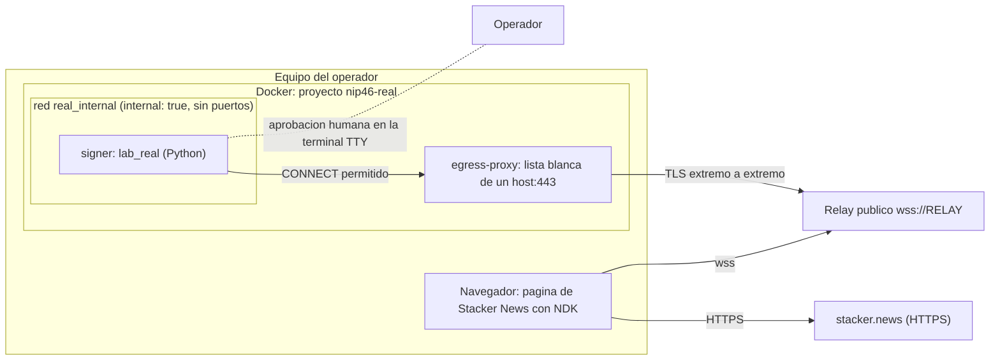

# Propuesta de alcance: Fase 1.0A.2, validación real con Stacker News

> **Estado posterior (2026-11-20):** este plan se ejecutó parcialmente: Compuertas A y B realizadas (observación sin firma); **las Compuertas C y D no**. Resultados y diferencias respecto a lo previsto en [phase-1.0A-closure.md](phase-1.0A-closure.md). El texto siguiente es el original.

**Documento de análisis y planificación. No se implementó nada, no se conectó a Stacker News ni a ningún relay, no se instaló ninguna dependencia, no se generó ninguna identidad.** Todo lo marcado **[D]** es una propuesta pendiente de aprobación.
Etiquetas: **[V]** verificado en código o datos locales ya disponibles; **[I]** inferencia; **[H]** hipótesis sin comprobar; **[LAB]** observado en la Fase 1.0A.1 (ver [nip46-lab-report.md](nip46-lab-report.md)). Relacionados: [stacker-news-compatibility.md](stacker-news-compatibility.md), [nip46-security-design.md](nip46-security-design.md), [nip46-implementation-plan.md](nip46-implementation-plan.md), [`lab/README.md`](../lab/README.md).

## 1. Resumen y recomendación

**Objetivo:** demostrar con una identidad desechable que Stacker News acepta un firmante Python mínimo, **antes** de construir el producto completo, para evitar retrabajo.

**Recomendación [D]:**

1. Un **firmante real mínimo** en el laboratorio (`lab/py/lab_real/`), que **reutiliza** la criptografía y el esqueleto del simulador ya validados, pero **sin** su motor de fallos, y con **aprobación humana por solicitud**, **política restrictiva para `kind 27235`** y evidencia sin secretos.
2. **Un solo relay `wss://`**: propuesta principal `wss://relay.nsec.app` (ver §6), sujeto a una **sonda previa** con autorización.
3. **Salida a Internet controlada:** el firmante vive en una red Docker `internal` y solo llega al relay a través de un **proxy de salida con lista blanca** de un único `host:443`.
4. **Ensayo general local** (nuevos experimentos E8-E10 con NDK real y el relay local) **antes** de tocar nada externo.
5. Cuatro compuertas de autorización, cada una con el alcance que exige `AGENTS.md` §11: sonda del relay, observación sin efecto en Stacker News (Ejecución 0), registro real con identidad desechable (Ejecución 1) y repetición (Ejecución 2, opcional).

Complejidad **media** (≈1 500 líneas con pruebas y documentación; **sin dependencias nuevas**). Riesgo principal: la disponibilidad y las reglas del relay público y el comportamiento de producción de Stacker News, ninguno verificable sin conectar.

## 2. Condiciones de conexión de Stacker News (lo que sabemos y lo que no)

Todo **[V]** sobre el commit `0a798c7` de `master`, no sobre producción **[H]**.

| # | Hallazgo | Evidencia | Consecuencia para la prueba |
|---|---|---|---|
| C1 | La entrada es un campo `bunker://… o dirección NIP-05`; no hay QR ni `nostrconnect://`. | `components/nostr-auth.js:222-226` | Flujo `bunker://`. |
| C2 | La ruta es `/login?type=nostr`; el registro usa la **misma** pantalla en `/signup`. | `components/login.js:110`; `pages/signup.js:34-42` | Para una identidad nueva se usa `/signup` **[I]** (la parte `?type=nostr` en `/signup` es inferida: el componente es el mismo). |
| C3 | **Iniciar sesión con una clave desconocida falla**: si la cookie `signin` está presente (la fija `/login`), `pubkeyAuth` devuelve `null` para una clave nueva. Un usuario nuevo **solo se crea desde `/signup`**. | `pages/api/auth/[...nextauth].js:227`; `components/login.js:91-97, 56-66` | **Una identidad desechable nueva debe registrarse con `/signup`.** Usar `/login` fallaría y confundiría el diagnóstico. |
| C4 | Registrarse crea un **usuario real** en Stacker News con `name = pubkey.slice(0,10)` y `nostrAuthPubkey = pubkey`. | `[...nextauth].js:228` | Efecto externo **persistente** (cuenta huérfana al descartar la clave): requiere autorización explícita y ver §13. |
| C5 | El cliente corre **en el navegador del operador** y abre WebSockets **desde el navegador** a los relays de la URI. | `components/nostr-auth.js`; `lib/nostr.js` | El relay debe ser alcanzable desde el navegador **y** desde el firmante. |
| C6 | La CSP de producción permite solo `wss:` y `https:` y fuerza `upgrade-insecure-requests`. | `proxy.js:230, 236` | Un relay local `ws://` no sirve para la prueba real **[V]**; un `wss://` local exigiría instalar una CA de confianza (cambio global, descartado) **[I]**. |
| C7 | La URI debe llevar ≥1 `relay` `wss://`; sin él NDK abre un pool vacío. | NDK `signers/nip46/index.ts:98-109`; [LAB] | La URI se construye con el relay elegido. |
| C8 | El servidor valida `id`, firma Schnorr y `tags[0] = ["challenge", k1]`; consume `k1`. **No valida** `kind`, `content`, `created_at`, `u` ni `method`. | `[...nextauth].js:196-270` | Nuestra política debe ser **más estricta** que el servidor (§9). |
| C9 | `k1` son 32 bytes aleatorios en hex (64 caracteres en minúsculas). El código leído **no** caduca ni limpia filas `LnAuth` huérfanas. | `api/resolvers/lnurl.js:12-14, 23-25`; búsqueda en `api/`, `worker/`, `lib/`, `pages/` | Un reto no usado puede seguir válido: la ventana de tiempo la impone **nuestro** firmante. |
| C10 | `u` es `process.env.NEXT_PUBLIC_URL`: en desarrollo `http://localhost:3000`; **el valor de producción no está en el repositorio**. | `.env.development:63`; `nostr-auth.js:153` | Se desconoce hasta observarlo: **Ejecución 0** (§13) lo descubre sin efectos. |
| C11 | No se encontró captcha ni límite de tasa específico en las rutas de login/registro/`createAuth` leídas. | búsqueda en `pages/api/auth`, `components/login.js`, `proxy.js`, `lnurl.js` | Antiabuso de producción **sin verificar [H]**. |
| C12 | NDK no impone tiempo máximo; la interfaz solo sugiere «use un token nuevo» tras 10 s. Si el firmante tarda en aprobar, la pantalla espera. | `nostr-auth.js:97-106`; [LAB] | La aprobación humana es viable. |

**Alternativa descartada: instancia local de Stacker News (`sndev`).** El repositorio incluye un entorno de desarrollo, pero su `docker-compose.yml` declara decenas de servicios (nodo Bitcoin, varios nodos Lightning, OpenSearch, correo, etc.) y recomienda OrbStack en Windows/macOS **[V]**. Exigiría descargar y ejecutar mucho código de terceros y no probaría producción. Si se quisiera cubrir solo la ruta de servidor, sería una fase aparte con su propia aprobación.

## 3. Arquitectura mínima



- **Red:** `real_internal` (`internal: true`) contiene solo el firmante y el proxy; el proxy además está en una red normal de salida. **El firmante no tiene ruta a Internet**; lo único que alcanza es el proxy, y este solo acepta `CONNECT` a **un** `host:443` configurado. El proxy no intercepta TLS: la verificación del certificado del relay la hace el firmante con la CA del sistema (la imagen trae 148 certificados y `CERT_REQUIRED` + `check_hostname` [V, comprobado sin red]).
- **Sin puertos publicados.** El operador interactúa por el terminal (`docker compose run`, con TTY).
- **El firmante nunca escribe secretos en disco.** Evidencia por un volumen de resultados excluido de Git (§11); la URI se muestra solo en la terminal interactiva y el servicio usa `logging: driver: none` para que Docker no conserve esa salida **[H: a comprobar en el ensayo]**.
- **`websockets` 17.4 ya soporta proxy** (parámetro `proxy` del cliente asyncio, HTTP `CONNECT`) [V, lectura de la rueda ya descargada]: **no hace falta ninguna dependencia nueva**. El proxy se escribe con la biblioteca estándar.
- **Mismo equipo, mismo reloj** para navegador y firmante: la ventana de `created_at` es fiable.

## 4. Componentes del laboratorio: reutilizables y separados

| Componente (`lab/`) | Decisión | Motivo |
|---|---|---|
| `py/lab_common/nostr.py`, `nip44.py`, `nip04.py` | **Reutilizar tal cual** | Pasan los vectores oficiales de NIP-44 (33 pruebas) y la prueba cruzada con `nostr-tools` (E5) [LAB]. |
| `py/lab_common/log.py` | Reutilizar y **ampliar** con filtro de redacción | Ya no registra secretos; se añade una lista de claves prohibidas como defensa en profundidad. |
| `py/lab_signer/simulator.py` | **Copiar el esqueleto, no importarlo**: bucle del relay, análisis de solicitudes, despacho de métodos y construcción de respuestas | Tiene el motor de fallos (`FAULT`), el archivo `/ctl`, el modo de respuesta configurable, el retardo aleatorio y `USE_SECRET` por entorno: **nada de eso debe existir en la ejecución real**. |
| `py/lab_relay/` | Solo para el **ensayo local** | La prueba real usa un relay público. |
| `node/client/main.mjs` (NDK real) | Reutilizar en el ensayo; **añadir** el escenario `e8` | Es el cliente que usa Stacker News. |
| `run_lab.py` | **Ampliar** con la etapa `rehearsal` | Reutiliza el orquestador y la evaluación. |
| `deps/artifacts.json`, Dockerfiles | **Sin cambios** | No hay dependencias nuevas; el código nuevo vive en `lab/py/lab_real/` y entra en la imagen por el `COPY` existente de `py/`. |

**Separación obligatoria del código productivo:** `app/` **no importa** nada de `lab/` ni al revés. `lab/py/lab_real/` importa solo `lab_common`, nunca `lab_signer`. Cuando exista el firmante productivo (Fase 1.0B), se **portará** el diseño y se ejecutará `lab/` como arnés de regresión contra él; el código del laboratorio no se promociona. Permanecen **solo en el laboratorio**: el motor de fallos, el simulador, el relay mínimo, el arnés NDK, el orquestador, el proxy de salida y la sonda del relay.

## 5. Cambios de código estrictamente necesarios

| Módulo nuevo (`lab/py/lab_real/`) | Responsabilidad | Tamaño aprox. |
|---|---|---|
| `signer.py` | Firmante real mínimo: conexión `wss://` por el proxy, suscripción, estados de conexión (Emitida → Pendiente → Activa), secreto de un solo uso con TTL, métodos `connect`, `get_public_key`, `sign_event`, `ping`; respuestas **NIP-44** con entrada NIP-04 aceptada (L-1 [LAB]); límite de firmas; interruptor de emergencia | 280 líneas |
| `policy.py` | Política de `kind 27235` (§9) como **funciones puras** | 130 |
| `approval.py` | Aprobación humana por solicitud en la terminal, con tiempo máximo y denegación por defecto; **guarda de seguridad**: la aprobación automática solo se permite si el relay es el del laboratorio | 90 |
| `evidence.py` | Escritor de evidencia JSONL con campos permitidos y redacción | 70 |
| `proxy.py` | Proxy `CONNECT` con lista blanca de un `host:puerto`; registra solo `host:puerto` y bytes | 90 |
| `probe.py` | Sonda del relay (publica un evento efímero con clave desechable y comprueba el viaje de ida y vuelta, `AUTH`, límites y latencia) | 100 |
| `verify_evidence.py` | Verificación sin conexión de un evento firmado (id y firma) | 40 |

Pruebas `unittest` (política, aprobación con doble, proxy, evidencia): ≈ 450 líneas. Cambios en lo existente: escenario `e8` en `node/client/main.mjs` (≈ 60 líneas) y etapa `rehearsal` en `run_lab.py` (≈ 120). Además `lab/real/compose.real.yaml` y `lab/real/README.md` (runbook). **Sin dependencias nuevas, sin cambios en `app/`, `pyproject.toml` ni `constraints.txt`.**

## 6. Relay `wss://` propuesto y riesgos

**Por qué hace falta uno público:** el navegador de Stacker News solo abre `wss:` (C6) y un `wss://` local exigiría confiar en una CA propia; un relay en una VM pública sería «desplegar servicios públicos» (fuera de alcance ahora).

**Propuesta principal: `wss://relay.nsec.app`.**
- **Evidencia [V]:** el README de nsec.app (repositorio `nostrband/noauth`) lo propone como relay para NIP-46 y advierte: *«no uses relays públicos de propósito general, alcanzarás los límites de tasa muy rápido»*. nsec.app es uno de los dos firmantes NIP-46 que la interfaz de Stacker News lista (`nostr-auth.js:296-316`). Es un relay hecho para este tráfico.
- **No verificado [H]:** que esté activo hoy, que acepte eventos de claves arbitrarias, si exige NIP-42 o alguna lista blanca, y sus límites. **No se puede comprobar sin conectar**; por eso la sonda previa (§13, paso 2).

**Reservas (en este orden, solo si la sonda del principal falla):** `wss://relay.primal.net` y `wss://relay.damus.io`, presentes en la lista que Stacker News usa para *crossposting* (`lib/nostr.js:9-15`, no es evidencia de que sirvan para NIP-46). Con la advertencia de nsec.app, pueden imponer límites de tasa **[H]**.

| Riesgo del relay | Prioridad | Mitigación |
|---|---|---|
| No disponible, rechaza la clave o limita la tasa | Alta | Sonda previa; una reserva; el flujo emite pocos eventos (≈ 6 por intento) |
| Exige NIP-42 (`AUTH`) | Media | La sonda lo detecta; si ocurre, se valora añadir NIP-42 (≈ 60 líneas) **con aprobación**, o se cambia de relay |
| Operador del relay ve metadatos: IP del equipo (navegador y firmante), claves públicas efímeras, horas, tamaños | Media | Aceptado con identidad desechable; el contenido va cifrado y los eventos son efímeros |
| Un relay hostil podría descartar, retrasar o repetir eventos | Media | La firma exterior protege la integridad; memoria de ids y ventana de tiempo; el peor caso es indisponibilidad |
| El primer mensaje de NDK va en NIP-04 (sin MAC) por un relay de terceros | Media | La integridad del evento la da la firma exterior; el contenido es un `connect` sin datos sensibles; riesgo aceptado y documentado (L-1 [LAB]) |

La URI llevará **exactamente un** `relay` para no multiplicar las variables (con varios, NDK publica en todos).

## 7. Identidad exclusivamente desechable

- Dos claves **distintas** (transporte e identidad) generadas **en memoria** al arrancar el firmante con el CSPRNG; **nunca** se guardan, se imprimen ni se registran (solo las públicas truncadas).
- **No se aceptan claves por argumento ni por entorno**: el código no tiene ninguna ruta para importar una clave; así no puede usarse una cuenta personal por error.
- Ciclo de vida = el del proceso. Al terminar, la identidad deja de existir. **Consecuencia [I]:** la cuenta creada en Stacker News (C4) queda **huérfana** (nadie podrá volver a iniciar sesión con esa clave); la prueba de repetición (Ejecución 2) debe hacerse **dentro de la misma sesión** del firmante. El propietario debe aceptar esa cuenta huérfana; no podemos eliminarla.
- Nada de datos personales en la identidad (sin perfil, sin nombre).

## 8. Aprobación humana de cada solicitud de firma

Mecanismo **[D]**: la terminal interactiva del firmante (TTY), sin puertos ni interfaz web.

- **`connect`:** muestra la clave pública del cliente (8 caracteres), que el secreto de un solo uso fue válido y la edad de la URI; pregunta `¿Activar esta conexión? [s/N]`. Mientras no se apruebe, la conexión está en **Pendiente** y no se responde nada más.
- **`sign_event`:** muestra el evento tal como llegó (`kind`, `created_at` en UTC con su antigüedad, etiquetas, `content`), el resultado de **cada comprobación de la política** (§9) y una huella; pregunta `¿Firmar UNA vez este evento? [s/N]`.
- **Una aprobación = una firma.** Cada firma consume la aprobación (concesión de un solo uso) antes de firmar.
- **Denegación por defecto:** cualquier respuesta distinta de `s`, `Ctrl+C` o un tiempo máximo (120 s) deniegan. NDK no impone tiempo máximo, así que denegar deja la pantalla de Stacker News esperando; se recarga y se repite [LAB].
- **Si la política rechaza el evento, no se ofrece aprobarlo**: no hay forma de firmar un evento fuera de política.
- **Guarda anti-automatización:** `APPROVAL_MODE=auto` (usado en el ensayo) se **rechaza** salvo que el relay sea el del laboratorio.

## 9. Política restrictiva para `kind 27235`

Aplica en este orden; **cualquier fallo rechaza** (falla de forma segura) y se registra la comprobación fallida, sin contenido.

| # | Comprobación | Valor propuesto |
|---|---|---|
| 1 | Evento de transporte válido (firma, `id`, `kind 24133`, `p` = clave de transporte), **antes de descifrar**, y no repetido | memoria de ids con TTL |
| 2 | Conexión en estado **Activa** y no revocada ni caducada | vida máxima 30 min |
| 3 | Aprobación humana vigente y **sin consumir** | un solo uso |
| 4 | `params` con exactamente un string, JSON de un objeto con campos permitidos (`kind`, `content`, `tags`, `created_at` y, solo para comprobarlos, `pubkey`, `id`) | campos desconocidos: rechazo |
| 5 | `kind == 27235` | único permitido |
| 6 | `pubkey` ausente o igual a la identidad; `id` ausente o igual al recalculado (NIP-01) | una diferencia se rechaza |
| 7 | **Caducidad:** `created_at` dentro de ±120 s del reloj y sin estar más de 30 s en el futuro | configurable |
| 8 | **Estructura:** exactamente 3 etiquetas, en este orden: `["challenge", reto]`, `["u", origen]`, `["method", "GET"]` | cualquier otra: rechazo |
| 9 | **Challenge:** 64 caracteres hexadecimales en minúsculas | formato del `k1` [V] |
| 10 | **Origen:** `u` **igual, carácter a carácter**, al valor configurado (`SN_ORIGIN`); sin barra final, esquema `https` | lista de un solo valor |
| 11 | `content == "Stacker News Authentication"` | igualdad exacta |
| 12 | Tamaño total del evento ≤ 1 KiB | anti-abuso |
| 13 | **Reutilización:** el SHA-256 del challenge **no** se vio antes en esta sesión | memoria de hashes |
| 14 | **Tope de firmas:** ≤ 2 por sesión; tras el tope el firmante se cierra | interruptor de emergencia |
| 15 | La aprobación se consume de forma **atómica antes de firmar**; el evento firmado se **auto-verifica** (id y Schnorr) antes de responder | — |

**Valores de Stacker News y su incertidumbre:** contenido, estructura y formato del reto son **[V] en `master`**; el valor exacto de `u` es **[H]**. **Ejecución 0** (§13) lo averigua **sin firmar nada**: el firmante muestra el `u` recibido y **deniega**; el operador lo anota y configura `SN_ORIGIN` para la Ejecución 1. Si `u` no coincide, el rechazo seguro **es el resultado esperado**, no un fallo.

## 10. Flujo completo de autenticación

```mermaid
sequenceDiagram
    autonumber
    actor O as Operador
    participant S as Firmante lab_real
    participant R as Relay wss
    participant B as Navegador NDK 2.12.2
    participant SN as Servidor Stacker News
    S->>R: REQ kinds 24133, p = clave de transporte
    R-->>S: EOSE
    S->>O: muestra la URI bunker una sola vez, solo en la terminal
    O->>B: abre /signup y pega la URI
    B->>SN: createAuth
    SN-->>B: k1 de un solo uso
    B->>R: EVENT connect, cifrado NIP-04
    R->>S: EVENT 24133
    S->>S: valida firma, descifra, valida secreto de un solo uso
    S->>O: Activar esta conexion?
    O-->>S: s
    S->>R: EVENT ack, cifrado NIP-44
    R->>B: EVENT 24133
    B->>R: EVENT get_public_key, NIP-44
    S->>R: EVENT clave de identidad, NIP-44
    B->>R: EVENT sign_event, kind 27235, NIP-44
    R->>S: EVENT 24133
    S->>S: politica de 15 comprobaciones
    S->>O: muestra el evento y las comprobaciones; Firmar UNA vez?
    O-->>S: s
    S->>S: consume aprobacion, firma, auto-verifica
    S->>R: EVENT evento firmado, NIP-44
    R->>B: EVENT 24133
    B->>SN: signIn nostr con el evento firmado
    SN->>SN: recalcula id, verifica Schnorr, tags 0 = challenge, consume k1, crea usuario
    SN-->>B: sesion iniciada
    O->>O: captura redactada de la interfaz y cierre del firmante
```

## 11. Captura de evidencia (éxito o fallo) sin secretos

**Registro del firmante (JSONL, volumen de resultados excluido de Git):** solo campos permitidos por `evidence.py`:

| Evento | Campos |
|---|---|
| `session_start` | versiones, host del relay, huella de la configuración (sin secretos), `SN_ORIGIN` |
| `relay_ready` | EOSE recibido y hora |
| `bunker_issued` | clave de transporte truncada (8) y TTL; **nunca la URI ni el secreto** |
| `request` | método, esquema (`nip04`/`nip44`), cliente (8), SHA-256 del texto plano |
| `decision` | `connect` o `sign_event`, aprobado o denegado por el humano, latencia |
| `policy` | lista de comprobaciones con pasa/falla, SHA-256 corto del challenge, `u`, antigüedad de `created_at` |
| `sign_ok` | `id` del evento, `tags[0]`, resultado de la **auto-verificación** |
| `response_published` | respuesta `OK` del relay |
| `session_end` | motivo (completada, denegada, tope, interruptor) |

- **Nunca se registran:** claves privadas, la URI `bunker://`, el secreto, texto descifrado, cookies ni cabeceras. El filtro de redacción rechaza cualquier campo fuera de la lista permitida.
- **Registro del proxy:** `host:puerto` y bytes, para demostrar **qué se contactó** y que no hubo nada más.
- **Evento firmado:** es un *token portador* mientras Stacker News no haya consumido el `k1`. Solo se guarda (para verificación sin conexión) **si el operador confirma que el login terminó** (el `k1` ya se consumió); si no, se guardan solo `id` y huellas.
- **Capturas manuales del operador:** de la interfaz de Stacker News tras el login y del perfil con el nombre `pubkey[:10]` (C4), **redactadas** (sin cookies ni datos personales). Se guardan fuera de Git hasta decidir qué se documenta.
- **Fallo:** el mismo registro sirve; se clasifica el fallo (§14).

## 12. Controles mínimos de seguridad

1. Identidad desechable en memoria, sin importación de claves; claves de transporte e identidad distintas.
2. Firmante en red `internal`, **sin ruta a Internet**; salida solo por el proxy con **un** `host:443`.
3. Sin puertos publicados; contenedores no root, FS de solo lectura, `cap_drop: ALL`, `no-new-privileges` (como en el laboratorio).
4. TLS verificado con la CA del sistema; el proxy no intercepta.
5. Secreto de conexión de ≥128 bits, TTL de 10 min, un solo uso, comparado en tiempo constante; conexión en **Pendiente** hasta aprobación humana.
6. Aprobación humana **por solicitud**, denegación por defecto y sin automatización contra relays reales.
7. Política de §9 con falla segura; `kind` distinto de `27235` rechazado; `nip04_*`/`nip44_*` y demás métodos denegados.
8. Memoria de ids de evento, de solicitud y de challenge; ventana de `created_at`.
9. Tope de **2 firmas por sesión**, vida máxima de la conexión y **interruptor de emergencia** (Ctrl+C revoca y sale).
10. Errores hacia el cliente genéricos y estables; sin distinguir fallos de descifrado.
11. Evidencia con lista de campos permitidos; sin secretos ni texto descifrado.
12. Sin dependencias nuevas ni ejecución de código remoto; las imágenes y artefactos son los ya verificados por hash.

## 13. Plan de ejecución paso a paso

Cada paso externo requiere una **autorización específica con el alcance de `AGENTS.md` §11** (plantilla al final). Ninguna autorización se extiende a otra.

| Paso | Qué | ¿Externo? | Resultado esperado |
|---|---|---|---|
| 0 | **Aprobar esta propuesta** y responder las preguntas de §18 | No | Alcance aprobado |
| 1 | Implementar `lab_real` y su compose; pruebas `unittest` de política, aprobación, proxy y evidencia | No | Pruebas en PASS |
| 2 | **Ensayo general local** con NDK 2.12.2 real y el relay del laboratorio: **E8** (política: evento correcto firma; `u` incorrecta, etiqueta extra, orden alterado, `kind` distinto, `created_at` viejo, `content` distinto y challenge repetido **se rechazan**), **E9** (denegación humana: NDK queda esperando y la política no firma), **E10** (ciclo completo con el proxy y la red `internal`, relay del laboratorio detrás del proxy) | No | E8-E10 en PASS; se comprueba también `logging: none` y el proxy |
| 3 | **Compuerta A, sonda del relay:** `probe.py` con una clave desechable y un evento efímero hacia `relay.nsec.app` (o la reserva) | **Sí**: un relay público | Go/no-go del relay: acepta, devuelve el evento, sin `AUTH`, latencia |
| 4 | **Compuerta B, Ejecución 0 (observación sin efecto):** `/signup?type=nostr` en Stacker News con el firmante en modo **denegar siempre la firma** | **Sí**: Stacker News y el relay | Se registra `u`, `content`, orden de etiquetas y formato del reto; **no se crea cuenta** [I: la cuenta se crea solo si se firma] |
| 5 | Ajustar `SN_ORIGIN` y la política con lo observado; repetir el ensayo local (E8) con ese valor | No | Política alineada |
| 6 | **Compuerta C, Ejecución 1 (registro real):** `/signup` con el firmante normal, aprobaciones humanas, **una** firma | **Sí**; **crea una cuenta real desechable** | Inicio de sesión completo (§14) |
| 7 | **Compuerta D, Ejecución 2 (opcional):** cerrar sesión y `/login?type=nostr` **con la misma sesión del firmante** | **Sí** | Reproducibilidad |
| 8 | Cierre: interruptor de emergencia, `docker compose down -v`, identidad destruida, verificación de que el proxy solo contactó el relay, evidencia redactada | No | Limpieza verificada |
| 9 | Consolidar en la Fase 1.0A.3 (informe, `decisions.md`, `ai-log.md`) | No | Cierre documental conjunto |

**Plantilla de autorización por compuerta (`AGENTS.md` §11):** servicio y relays concretos; identidad o cuenta de prueba **designada** (la desechable del firmante, nunca personal); operaciones permitidas (A: publicar y leer un evento efímero; B: abrir la pantalla y pegar la URI **sin firmar**; C: una firma `27235` y la creación de la cuenta; D: un segundo inicio de sesión); duración (p. ej. 30 min por compuerta); restricciones (un solo relay, sin otras páginas ni acciones en Stacker News, sin publicar contenido, sin guardar la URI, evidencia redactada, abortar según §14).

## 14. Criterios de éxito, fallo y aborto

**Niveles de evidencia** (los de la Fase 0.3, ampliados):

| Nivel | Evidencia | ¿Demuestra login? |
|---|---|---|
| S0 | Sonda del relay correcta | No |
| S1 | Firmante suscrito por `wss` (EOSE) | No |
| S2 | Stacker News aceptó la URI y llegó un `connect` descifrado, aprobado | No |
| S3 | `get_public_key` respondido | No |
| S4 | `sign_event` pasó la política, fue aprobado, firmado, **auto-verificado** y publicado (`OK` del relay) | No: demuestra la criptografía, no que Stacker News lo acepte |
| **S5** | **Login completo:** la interfaz de Stacker News muestra la sesión iniciada **y** el usuario nuevo se llama como los 10 primeros caracteres hexadecimales de la clave pública (C4), y la sesión persiste al recargar | **Sí** |
| S6 | Segundo inicio de sesión en la misma sesión del firmante | Refuerza |

**Éxito de la validación real:** S5 en la Ejecución 1. **Fallo** (con su clasificación): relay (no conecta, `AUTH`, límite de tasa), conexión (NDK no llega a conectar), criptografía (descifrado o MAC), política (rechaza un evento legítimo: se ajusta `SN_ORIGIN` o la política), servidor de Stacker News (rechaza el evento firmado), registro (C3: se usó `/login` con una clave nueva), tiempo (aprobación demasiado lenta, URI caducada).

**Reglas de aborto inmediato:** el proxy registra un `host:puerto` distinto del autorizado; llega un `kind` distinto de `27235` o un método inesperado; challenge repetido; se alcanza el tope de firmas; aparece cualquier secreto en la evidencia; el relay limita la tasa; cualquier comportamiento fuera del alcance autorizado.

## 15. Complejidad y riesgos principales

| Riesgo | Prioridad | Comentario |
|---|---|---|
| Relay público: disponibilidad, `AUTH`, límites, política desconocida | Alta | Sonda previa y reserva; no verificable ahora |
| Producción de Stacker News distinta de `master` (versión de NDK, interfaz, antiabuso, `u`) | Alta | La Ejecución 0 sin efectos reduce el riesgo antes de crear nada |
| La cuenta creada queda huérfana y es un efecto externo persistente | Media | Aceptación expresa del propietario; sin datos personales |
| Un proxy de salida con lista blanca y `logging: none` en Docker Desktop (Windows) | Media | Se comprueba en el ensayo local, antes de salir |
| Aprobación humana lenta frente a la caducidad de la URI (TTL de 10 min) | Baja | Operador preparado; se puede emitir otra URI |
| Extensiones o bloqueadores del navegador que corten `wss` | Baja | Perfil limpio del navegador |
| Metadatos expuestos al operador del relay (IP, claves efímeras) | Media | Aceptado con identidad desechable |
| El primer mensaje en NIP-04 viaja por un relay de terceros | Media | Aceptado y documentado |

**Complejidad: media.** Reutiliza lo validado y no añade dependencias. Esfuerzo estimado: tres o cuatro sesiones de trabajo para la parte local (pasos 1-2, ≈ 1 500 líneas con pruebas) y una sesión por cada compuerta externa. La parte difícil no es el código, sino lo que no podemos saber de antemano (relay y producción).

## 16. Archivos

**Crear:**
- `lab/py/lab_real/` (`__init__.py`, `signer.py`, `policy.py`, `approval.py`, `evidence.py`, `proxy.py`, `probe.py`, `verify_evidence.py`)
- `lab/py/tests/test_real_policy.py`, `test_real_approval.py`, `test_real_proxy.py`, `test_real_evidence.py`
- `lab/real/compose.real.yaml` y `lab/real/README.md` (runbook)
- `lab/experiments/definitions-real.md` (criterios fijados de E8-E10 y de la validación real)

**Modificar:**
- `lab/node/client/main.mjs` (escenario `e8`)
- `lab/run_lab.py` (etapa `rehearsal`)
- `lab/py/lab_common/log.py` (filtro de redacción)

**No tocar:** `app/`, `pyproject.toml`, `constraints.txt`, `lab/deps/`, los Dockerfiles, `AGENTS.md`, `CLAUDE.md`. `lab/results/` ya está excluido de Git. El cierre documental queda para la 1.0A.3.

## 17. Alternativas descartadas

| Alternativa | Motivo |
|---|---|
| Relay local `ws://` | La CSP de producción solo permite `wss:` [V] |
| Relay local `wss://` con CA propia | Exige confiar en una CA en el equipo (cambio global) |
| Relay propio en una VM pública | «Desplegar servicios públicos» queda fuera de alcance |
| Login por NIP-05 | Exige servir `/.well-known/nostr.json` por HTTPS en un dominio propio |
| `nostrconnect://` | Stacker News no lo ofrece [V] |
| Instancia local de Stacker News (`sndev`) | Decenas de servicios y mucho código de terceros; no prueba producción |
| Aprobación por `auth_url` y página web | Exigiría un puerto publicado y una interfaz; la terminal es más simple y suficiente |
| Cuenta personal o clave persistente | Prohibido; la identidad es desechable |

## 18. Decisiones pendientes para el propietario

1. ¿Se aprueba la arquitectura (firmante en red `internal` + proxy con lista blanca de un `host:443`)?
2. ¿Se aprueba `wss://relay.nsec.app` como relay principal con sonda previa, y las dos reservas?
3. ¿Se acepta **crear una cuenta real desechable en Stacker News** (efecto persistente, cuenta huérfana tras descartar la clave), revisando antes sus condiciones de uso?
4. ¿Se aprueba la Ejecución 0 **sin efectos** (denegar siempre la firma) para descubrir `u`?
5. ¿Se aprueba el tope de 2 firmas por sesión y la ventana de ±120 s?
6. ¿Se aprueba la implementación local (pasos 1-2) **sin conexiones externas** como siguiente paso?
7. ¿Se conservan las capturas manuales fuera de Git hasta la 1.0A.3?
