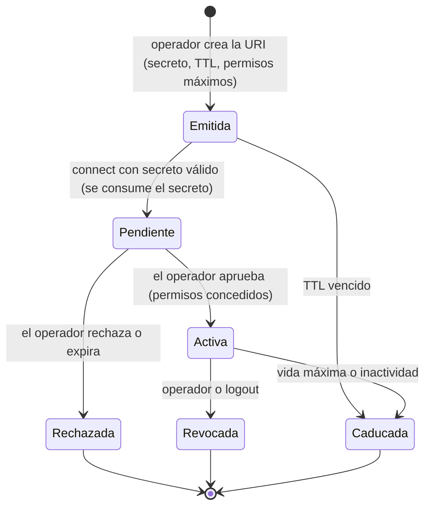

# Diseño de seguridad del firmante remoto NIP-46

**Fase 0.3: diseño. Nada de esto está implementado ni aprobado.** Todo lo marcado **[D]** es una propuesta pendiente de aprobación del propietario (ver `docs/decisions.md`).
Etiquetas: **[V]** verificado en una fuente, **[I]** inferencia, **[H]** hipótesis, **[D]** decisión propuesta. Documentos relacionados: [nip46-protocol-analysis.md](nip46-protocol-analysis.md), [stacker-news-compatibility.md](stacker-news-compatibility.md), [nip46-implementation-plan.md](nip46-implementation-plan.md). Las reglas generales están en `AGENTS.md` §7, que este documento **no relaja**.

## 1. Alcance y supuestos

- Un firmante que custodia una clave de identidad Nostr **de prueba** y firma eventos para clientes autorizados a través de relays.
- Despliegue local y de demostración (una persona operadora). No es un servicio multiusuario en producción.
- Los relays **no son de confianza**: pueden leer metadatos, duplicar, reordenar o reenviar eventos [I].
- El cliente (navegador con NDK) **no es de confianza** para decidir autorizaciones: sus metadatos no están autenticados [V, NIP-46].
- **No se usan claves personales reales** en ninguna fase de investigación o prueba. La identidad de prueba se genera para el caso y se descarta después.

## 1.1 Medidas obligatorias para el primer prototipo y mejoras posteriores

Clasificación **[D]** (propuesta pendiente de aprobación). «Prototipo» = el primer incremento descrito en el plan de implementación, orientado a la demostración real con una identidad de prueba.

### Obligatorias para el primer prototipo

| # | Medida | Dónde se detalla |
|---|---|---|
| M1 | **Autorización explícita de cada cliente**: estados Emitida → Pendiente → Activa; solo una conexión Activa puede operar; la aprobación humana es un paso separado del `connect` | §5 |
| M2 | Secreto de conexión de ≥128 bits, **TTL corto, un solo uso**, solo se guarda su hash | §5.2 |
| M3 | **Denegar por defecto**: una clave de cliente desconocida solo puede enviar `connect` | §5.2, §9 |
| M4 | **`sign_event` restringido a `kind 27235`**; `nip04_*` y `nip44_*` denegados | §6.1 |
| M5 | **Validación del evento antes de firmar** (14 comprobaciones, falla segura) | §6.2 |
| M6 | **Desafío de autenticación como operación sensible**: concesión de un solo uso por aprobación humana, auditoría y límite de tasa | §6.3 |
| M7 | **Control de solicitudes repetidas**: firma y `id` verificados antes de descifrar, ids de evento y de solicitud vistos, ventana de `created_at`, reto de un solo uso | §7 |
| M8 | **Prevención de firma indiscriminada**: sin edición del evento, perfil de servicio configurable, sin otras etiquetas, tope de tamaño, límite de tasa | §6.1, §6.2 |
| M9 | Logs sin secretos, errores genéricos hacia el cliente, auditoría de firmas | §8 |
| M10 | Claves de **transporte e identidad separadas**, cifrado en reposo con AEAD y clave externa, sin claves reales | §3, §4 |
| M11 | **Revocación** (API y `logout`), vida máxima e inactividad, interruptor de emergencia | §9 |
| M12 | NIP-04 entrante **solo** configurable y registrado | §10 |

### Mejoras posteriores

| # | Mejora | Motivo de posponerla |
|---|---|---|
| L1 | Concesiones persistentes («recordar») con `u` fijado y revocables | Aumenta el riesgo; el prototipo exige aprobar cada login |
| L2 | Aprobación mediante `auth_url` | Comodidad; el prototipo usa la API local |
| L3 | Memoria de repetición, conexiones y auditoría en SQLite | Requiere esquema aprobado (T12) |
| L4 | Confirmación por firma para `kind` sensibles al permitir más tipos de evento | En el prototipo no se firma ningún otro `kind` |
| L5 | Perfiles de política para otros servicios además de Stacker News | Alcance |
| L6 | Rotación programada de la clave de transporte, alertas y métricas | Operación |
| L7 | Bloqueo de dependencias con hashes (alternativa B) y auditoría de vulnerabilidades | Antes de manejar claves reales, no para el prototipo de pruebas |
| L8 | HSM, proceso aislado o enclave para las claves | Fuera de alcance |
| L9 | Autenticación reforzada (segundo factor) para aprobar conexiones | Con la API protegida por JWT, en su fase |
| L10 | Permisos de cifrado (`nip44_*`/`nip04_*`) con restricciones por destinatario | No hacen falta para el login |

## 2. Activos y amenazas

| # | Activo / amenaza | Impacto | Mitigación **[D]** |
|---|---|---|---|
| T1 | Robo de la clave de identidad (en disco, memoria, logs o respuestas) | Total: suplantación permanente | Cifrado en reposo con AEAD, clave externa, módulo mínimo, nunca en logs/URLs/errores (§4) |
| T2 | Robo de la clave de transporte | Alto: suplantar al firmante ante clientes y leer tráfico | Es distinta de la identidad; misma protección en reposo; rotable (§3) |
| T3 | Cliente no autorizado pide firmas | Alto | Autorización explícita por cliente, secreto de un solo uso, permisos por método y `kind` (§5) |
| T4 | Suplantación del flujo de conexión (alguien usa el secreto antes que el usuario legítimo) | Alto | Secreto aleatorio de ≥128 bits, TTL corto, un solo uso, **aprobación humana** posterior (§5.2) |
| T5 | Repetición de solicitudes o eventos | Alto | Ventana de `created_at`, memoria de ids, `id` de solicitud único por cliente (§7) |
| T6 | Firma de eventos con un `kind` peligroso (perfil, contactos, borrados, mensajes) | Alto | Lista de `kind` permitidos por conexión; confirmación para `kind` sensibles (§6) |
| T7 | Uso del firmante para obtener tokens HTTP válidos (`kind 27235`) hacia **otros** servicios | Alto **[I]** | Restricción de `u`, `method` y estructura del evento (§6) |
| T8 | Oráculo de cifrado (`nip44_*`, `nip04_*`) con la clave del usuario | Medio-alto | Permiso explícito; desactivado por defecto (§6) |
| T9 | Fuga por logs, trazas o cabeceras | Alto | Política de logs estricta (§8) |
| T10 | Eventos malformados, cargas enormes (DoS) | Medio | Validación estricta, límites de tamaño y de tasa (§7, §9) |
| T11 | Relay malicioso o inestable | Medio | Validar todo evento recibido; varios relays; reconexión acotada |
| T12 | Debilidad de NIP-04 (sin MAC, CBC) | Medio | Solo entrante, configurable y registrado; firma del evento exterior validada antes de descifrar (§10) |
| T13 | Sesión robada o clave de cliente comprometida | Medio | Revocación inmediata, vida máxima e inactividad (§9) |
| T14 | `auth_url` usado para phishing | Medio | La URL apunta solo a nuestro origen y lleva un identificador opaco de un solo uso (§5.3) |
| T15 | Cadena de suministro (dependencias criptográficas) | Alto | Versiones fijadas (`constraints.txt`); evaluar bloqueo con hashes antes de manejar claves (decisión pendiente) |

## 3. Separación de claves

| Clave | Quién la genera | Dónde vive | Rol |
|---|---|---|---|
| **Identidad (usuario)** | El firmante, con CSPRNG, **solo para pruebas** en esta fase | Almacén cifrado del firmante; nunca sale | Firma el contenido de `sign_event`. Su clave pública es lo que Stacker News reconoce. |
| **Transporte (firmante remoto)** | El firmante, con CSPRNG | Almacén cifrado, **distinta** de la de identidad | Autor de los eventos `kind 24133` de respuesta y destino de las solicitudes (`p`). Aparece en `bunker://`. |
| **Cliente** | El cliente, desechable | En el navegador; **el firmante solo la ve** | Identifica la sesión. Se registra su clave **pública** al autorizar. |

- **[D]** Usar tipos distintos en el código (`UserKey`, `TransportKey`) para que no se puedan intercambiar por error. NIP-46 permite que sean la misma clave, pero eso mezclaría el riesgo de T1 y T2 [I].
- `get_public_key` devuelve la clave de **identidad**; `bunker://` lleva la de **transporte** [V, NIP-46].
- **Generación de claves de prueba [D]:** mediante un comando explícito que las crea con CSPRNG, las guarda cifradas y **muestra solo la clave pública** (`npub`). Nunca imprime la privada, no la acepta por argumento de línea de comandos y no existe en el repositorio, en la documentación ni en los logs. Para recuperarla (p. ej. importarla a otra herramienta), un comando de exportación independiente con confirmación explícita, que **no se implementará** en la primera iteración.
- Rotación: la clave de transporte puede rotarse sin cambiar la identidad (invalida las URI emitidas y obliga a reconectar).

## 4. Protección de claves privadas

| Medida **[D]** | Detalle |
|---|---|
| Cifrado en reposo | AEAD autenticado (p. ej. ChaCha20-Poly1305 o AES-GCM de `cryptography`), nonce único por cifrado, esquema documentado en `docs/decisions.md` antes de implementarlo (exigido por `AGENTS.md` §7). |
| Clave de cifrado externa | Variable de entorno/secreto (nunca en el repositorio ni en la imagen Docker). Se valida al arrancar; sin ella, el servicio **no inicia**. |
| Módulo mínimo y auditable | Un único módulo (`security/key_vault`) toca claves privadas; el resto del código recibe objetos opacos que firman y cifran, sin exponer el secreto. |
| Sin copias | Las claves no se serializan, no se registran, no se devuelven por la API ni se incluyen en excepciones. `__repr__` oculta el valor. |
| Memoria | **Limitación honesta [I]:** Python no garantiza borrar secretos de memoria (cadenas inmutables, recolector de basura). Se minimiza el tiempo y las copias, pero no se puede asegurar su borrado. Para un riesgo mayor haría falta un HSM, un proceso aislado o un enclave: fuera de alcance. |
| Comparaciones | Tiempo constante para secretos, MAC y tokens (`hmac.compare_digest`). |
| Bibliotecas | Solo bibliotecas establecidas (ver plan §3). **No se inventa criptografía**; NIP-44 se implementa según la especificación, componiendo primitivas de bibliotecas, y se valida con los vectores oficiales. |

## 5. Autorización de clientes

### 5.1 Estados de una conexión

### 5.2 Reglas **[D]**

1. **Una conexión se crea solo por una acción explícita del operador** (API local autenticada; en fases posteriores, con JWT). La URI `bunker://` contiene un secreto aleatorio de ≥128 bits, con **TTL corto** (propuesta: 10 minutos, como nsec.app [V]) y de **un solo uso**.
2. El secreto **no se guarda en claro**: se guarda su hash y se compara en tiempo constante. Tras su uso, se descarta.
3. `connect` con secreto válido deja la conexión en **Pendiente**: el secreto prueba que el cliente tiene la URI, no que el operador lo apruebe. **Solo `Activa` puede firmar o cifrar.** Para la demostración, el operador puede aprobar con un único comando o clic, pero debe ser un paso **explícito y separado**. La aprobación incluye la **concesión de un solo uso** para firmar el evento de autenticación (§6.3).
4. Se registra la **clave pública** del cliente; los metadatos que envíe (`name`, `url`…) son solo **texto de visualización** y nunca deciden la autorización [V, NIP-46].
5. Denegar por defecto: una clave de cliente desconocida solo puede enviar `connect`; cualquier otro método recibe una negativa genérica o se ignora (ver §9).
6. Autorización explícita en cada endpoint de la API y acceso solo a los recursos propios (`AGENTS.md` §7).

### 5.3 Aprobación mediante `auth_url` (opcional)

NIP-46 define un reto `auth_url` y Stacker News lo muestra con un botón «open signer» [V]. **[D]** Puede usarse para que la aprobación humana ocurra en una página **nuestra** sin que el cliente tenga que cambiar: el firmante responde `auth_url` con una URL de nuestro origen que lleva un **identificador opaco de un solo uso** (nunca el secreto ni claves), y cuando el operador aprueba, envía la respuesta definitiva con el **mismo `id`** [V, NIP-46]. La URL solo se emite a una conexión en estado Pendiente y caduca. Mitiga T14: Stacker News solo abre `http(s)` [V] y el contenido de la URL no confiere ninguna autoridad por sí mismo.

## 6. Permisos por operación

Los permisos son **explícitos y mínimos** (`AGENTS.md` §7) y los **concede el firmante**, no el cliente: NIP-46 dice que los permisos de `connect` son «solicitados» [V], y NDK 2.12.2 ni siquiera los envía [V].

| Permiso | Predeterminado | Notas |
|---|---|---|
| `connect`, `get_public_key`, `ping` | Permitidos a una conexión Activa | `get_public_key` es necesario para que el login funcione [V]. |
| `sign_event:<kind>` | **Denegado** salvo los `kind` concedidos | Para Stacker News: solo `sign_event:27235`, con **concesión de un solo uso** (§6.3) y validación completa (§6.2). |
| `nip44_encrypt/decrypt`, `nip04_encrypt/decrypt` | **Denegados** | No hacen falta para el login [V]. Un oráculo de cifrado con la clave del usuario es peligroso (T8). |
| `switch_relays`, `logout` | Permitidos | Respuestas mínimas; `logout` revoca la conexión. |

### 6.1 Política de firma del primer prototipo **[D]**

Mitiga T6 y T7. Un evento `kind 27235` (NIP-98, «HTTP Auth») es un **token portador** de HTTP: firmar uno arbitrario permitiría a un cliente actuar como el usuario ante cualquier servicio que acepte NIP-98 [I]. Por eso el firmante **no firma «lo que se le pida»**: firma solo lo que su política autoriza expresamente.

| Regla | Detalle |
|---|---|
| Un solo `kind` | Solo `27235`. Cualquier otro `kind` se rechaza con un error genérico. |
| Permiso explícito | `sign_event:27235` concedido **por el operador** al aprobar la conexión; el cliente no puede concederse permisos. |
| Perfil de servicio configurable | Los valores que identifican «un login de Stacker News» salen de un **perfil de configuración**, no del cliente: contenido esperado, lista blanca de `u`, formato del reto. Valores iniciales según el código leído (ver §6.2). |
| Sin edición | El firmante **no modifica** ningún campo del evento (la firma se calcula sobre exactamente lo que el cliente envió); si algo no cumple, rechaza. |

### 6.2 Validación de `sign_event` antes de firmar **[D]**

Orden de comprobaciones; **cualquier fallo rechaza** (falla de forma segura) con un error genérico y deja constancia en la auditoría **sin el contenido del evento**:

| # | Comprobación | Base |
|---|---|---|
| 1 | El evento de transporte es válido (firma, `id`, `kind 24133`, etiqueta `p` propia) y **no está repetido**; se verifica **antes** de descifrar | NIP-44, NIP-01 |
| 2 | La clave del cliente está en estado **Activa**, no revocada ni caducada | §5 |
| 3 | El método está permitido y existe el permiso `sign_event:27235` **y una concesión de un solo uso sin consumir** (§6.3) | §6.3 |
| 4 | `params` es un arreglo con **exactamente un string**; el string es JSON de un objeto con esquema estricto (`kind`, `content`, `tags`, `created_at`; se admiten `pubkey`, `id` y `sig` solo para comprobarlos); **campos desconocidos se rechazan** | NIP-46; NDK envía `pubkey` e `id` [V] |
| 5 | `kind` es entero y **igual a 27235** | §6.1 |
| 6 | Si llega `pubkey`, es **idéntica a la clave de identidad**; `sig` se ignora; si llega `id`, debe ser **igual al recalculado** (NIP-01). Una diferencia indica error de serialización o manipulación y **se rechaza**. Los dos casos son valiosos como diagnóstico en la Fase 1.0 | NDK calcula el `id` por su cuenta [V] |
| 7 | `created_at` es entero y está dentro de la **ventana** (±10 minutos propuestos) respecto del reloj local | NIP-98 sugiere 60 s para servidores [V]; Stacker News no lo valida [V] |
| 8 | `tags` es un arreglo de arreglos de strings; `tags[0]` es **`["challenge", <reto>]`** de longitud 2; hay exactamente una etiqueta `u` con valor **dentro de la lista blanca** y una etiqueta `method` igual a `GET`; **no hay otras etiquetas** | Estructura que firma Stacker News [V]; el servidor exige `tags[0]` [V] |
| 9 | El `<reto>` cumple el formato del perfil: para Stacker News, **64 caracteres hexadecimales** | `k1` = 32 bytes aleatorios en hex [V, `api/resolvers/lnurl.js:12-14`] |
| 10 | `content` es **exactamente** el texto del perfil (`"Stacker News Authentication"`) | [V, `components/nostr-auth.js:156`] |
| 11 | Tamaño total del evento acotado (propuesta: 4 KiB) | Anti-abuso |
| 12 | El **reto no se ha visto antes** para esta identidad (control de repetición del reto) | §7 |
| 13 | La concesión de un solo uso se **consume de forma atómica antes de firmar**, de modo que dos solicitudes simultáneas no obtengan dos firmas | §6.3 |
| 14 | Se firma, se responde y se registra la **auditoría**: clave del cliente truncada, `kind`, hash corto del reto, resultado | §8 |

Los valores del perfil de Stacker News (`u`, `content`, formato del reto) están **verificados en el código de la rama `master`**, no en producción **[H]**. El valor exacto de `u` es `NEXT_PUBLIC_URL`, una variable de entorno del despliegue que **no se conoce**: se confirma en la primera conexión de laboratorio o real, y se fija en la lista blanca tras la aprobación humana.

### 6.3 Desafíos de autenticación como operaciones sensibles **[D]**

Un desafío de autenticación (el `k1` de Stacker News) convierte una firma en una **sesión** en un servicio. Se trata como operación sensible, no como una firma rutinaria:

1. **La aprobación humana de la conexión incluye una concesión de un solo uso** para `sign_event:27235`: autoriza **exactamente una autenticación** y caduca (propuesta: 10 minutos). Para repetir el login hay que aprobar de nuevo.
2. Al aprobar, la persona operadora ve **qué identidad** se autenticará (clave pública de identidad) y **ante qué servicio** (`u` configurado).
3. Cada autenticación firmada deja una entrada de **auditoría** distinta de los logs de depuración.
4. El **reto es de un solo uso** del lado del firmante también (§7): un mismo reto no se firma dos veces.
5. **Límite de tasa** por conexión y global, y un tope de concesiones pendientes.
6. El firmante nunca **firma por adelantado** ni en lote: cada firma responde a una solicitud concreta, validada y con concesión vigente.

Esto sigue la preferencia del propietario de **confirmación antes de firmar eventos sensibles** (`AGENTS.md`, prompt de la Fase 0.3) sin introducir una segunda confirmación por firma en el primer prototipo.

### 6.4 `kind` sensibles (mejora posterior)

Cuando se permitan más `kind`, se definirán como **sensibles**, con confirmación humana por cada firma aunque exista permiso general: `0` (perfil), `3` (contactos), `5` (borrado), `4`, `14` y `1059` (mensajes privados), `10002`, `22242` y `24133`. En el primer prototipo **ninguno es firmable**, por lo que esta lista no se aplica todavía.

## 7. Validación y prevención de repetición

| Control **[D]** | Detalle |
|---|---|
| Validación estricta | Pydantic estricto para el evento de transporte, la solicitud, los parámetros y los eventos a firmar. Tipos, longitudes, hex en minúsculas y estructura de etiquetas. |
| Evento de transporte | Se verifica `id` y firma BIP-340 **antes de descifrar**, `kind == 24133`, etiqueta `p` igual a nuestra clave de transporte, `pubkey` de 32 bytes válida. |
| Tamaño | Máximo de la carga NIP-44 propio (propuesta: 64 KiB; **restricción provisional del prototipo, no una regla de la especificación**), comprobado **antes** de decodificar base64 [V, NIP-44 lo recomienda]. |
| Ventana temporal | `created_at` del evento dentro de ±(propuesta: 10 minutos) respecto del reloj local; se ajusta si la prueba real revela desfases. |
| Eventos repetidos | Memoria acotada de ids de evento vistos (TTL ≥ ventana): un id repetido se descarta. |
| Solicitudes repetidas | `id` de solicitud único por clave de cliente dentro de la ventana: un duplicado se descarta o se responde con el resultado cacheado **sin volver a ejecutar** (especialmente `sign_event`). |
| Secreto de conexión | Un solo uso; un segundo intento con el mismo secreto se ignora [V, NIP-46 lo pide]. |
| Reto de autenticación | El valor de la etiqueta `challenge` se recuerda por identidad (TTL ≥ ventana): un reto repetido **no se firma dos veces**, aunque llegue en otra solicitud o desde otro cliente. Complementa el control del servidor de Stacker News, que borra el `k1` tras usarlo [V]. |
| Concesión de firma | De un solo uso y consumida de forma **atómica antes de firmar** (§6.2, paso 13). |
| Respuestas | Mismo `id` que la solicitud; nunca se reenvía una respuesta salvo el flujo `auth_url`. |
| Persistencia | La memoria de ids y las conexiones se guardarán en SQLite en una fase posterior; la primera iteración puede usar memoria **con la limitación de perderla al reiniciar** (mitigada por la ventana de `created_at`). |

## 8. Registro seguro (logs) y errores

**Prohibido registrar** [V, `AGENTS.md` §7]: claves privadas, secretos de conexión, tokens, **contenido descifrado de mensajes NIP-46**, URI `bunker://` completas (llevan el secreto), cabeceras `Authorization`, cookies y datos personales.

**[D]** Reglas concretas:

- Se registran **hechos mínimos**: tipo de evento, método, resultado (`permitido`/`denegado`/`error`), clave pública **truncada** (p. ej. 8 primeros hex), un **identificador de correlación** derivado (no el `id` de solicitud completo), `kind` firmado y hash corto del evento firmado.
- Filtro central de redacción en `logging` y niveles bajos para `websockets`, `uvicorn` y `httpx`, de modo que no vuelquen cabeceras ni cuerpos (`AGENTS.md` §7).
- **Errores hacia el cliente NIP-46** (campo `error`): cadenas **genéricas y estables** (`unauthorized`, `unsupported method`, `invalid params`, `rate limited`, `internal error`), sin trazas, rutas ni detalles criptográficos. El detalle va solo a logs, sin datos sensibles. Los **errores de descifrado o de MAC no se distinguen** hacia el exterior.
- Auditoría de firmas separada de los logs de depuración y sin contenido del evento.

## 9. Revocación, caducidad y límites

| Mecanismo **[D]** | Detalle |
|---|---|
| Revocación inmediata | Por la API del operador y por `logout` (responder `ack` **antes** de borrar la sesión [V]). Tras revocar, las solicitudes de esa clave se rechazan; `logout` es una cortesía del cliente y **no una frontera de seguridad** [V]. |
| Caducidad | Vida máxima de la conexión (propuesta: 24 h para la demostración) e inactividad máxima. |
| Respuesta a clientes desconocidos o revocados | Ignorar (no responder) a claves desconocidas salvo `connect` válido, para no servir de amplificador ni de oráculo; a revocados, un error genérico para evitar que un cliente legítimo quede colgado. |
| Límite de tasa | Por clave de cliente y global (solicitudes por minuto), y tope de conexiones simultáneas. |
| Interruptor de emergencia | Un comando que revoca **todas** las conexiones y detiene la suscripción a relays. |
| API local | Escucha solo en `127.0.0.1` (ya así en Compose); los endpoints de aprobación y revocación requieren autenticación (JWT, en su fase) y límite de tasa. **JWT no reemplaza NIP-46** (`AGENTS.md` §3). |

## 10. NIP-04 como compatibilidad entrante

Stacker News (NDK 2.12.2) arranca con NIP-04 [V], contra la recomendación de la spec. **[D]** Política acotada:

1. **Configurable** (por ejemplo `NIP46_ALLOW_NIP04=true`), y **registrado** cada vez que se usa.
2. **Solo entrante para el transporte**: el firmante **responde en NIP-44** por defecto (como nsec.app [V]); el modo «espejar» queda como contingencia. **Ese valor por defecto es provisional**: se confirma o se invierte según los experimentos E1, E2 y E4 de [stacker-news-compatibility.md](stacker-news-compatibility.md) §3.5 (NDK adapta su esquema por detección de formato [V], pero una respuesta NIP-44 a una solicitud NIP-04 no está validada de extremo a extremo).
3. NIP-04 **no se usa** para responder a `nip04_encrypt/decrypt` de clientes salvo permiso explícito (ver §6).
4. El evento exterior se valida **antes** de descifrar, para que un atacante no obtenga un oráculo de relleno CBC [I].
5. Se documenta como **riesgo aceptado** y se retira en cuanto el cliente soporte NIP-44 de forma nativa.

## 11. Higiene de las pruebas

- Identidad Nostr **exclusiva** para pruebas y cuenta de prueba en Stacker News; **nunca** una cuenta personal (`AGENTS.md` §11).
- No se guardan en el repositorio claves, URI `bunker://`, cookies de Stacker News ni capturas con datos reales: la evidencia se **redacta** antes de guardarse (ver plan §6).
- Los relays públicos reciben solo eventos de transporte cifrados y efímeros. Aun así, **revelan metadatos** (claves públicas, horas, tamaños) [V, NIP-44 «Limitations»].

## 12. Riesgos residuales

| Riesgo | Prioridad | Comentario |
|---|---|---|
| Dependencia de NIP-04 | Alta | Inevitable con el cliente actual; aislado y registrado. |
| Secretos en memoria de Python | Media | No eliminable en Python; se minimiza. |
| Sin hashes en las dependencias | Media | Antes de manejar claves, evaluar la alternativa B de `docs/decisions.md`. |
| Metadatos visibles en relays | Media | Inherente a Nostr. |
| Reinicio pierde la memoria de repetición (primera iteración) | Baja | Mitigado con la ventana de `created_at`; resuelto con SQLite. |
| Aprobación humana mal diseñada (fatiga de clics) | Media | Permisos mínimos; concesión de un solo uso; `kind` sensibles con confirmación obligatoria al ampliarlos. |
| Valores del perfil de Stacker News (`u`, contenido, formato del reto) verificados solo en `master` | Media | Confirmar en laboratorio o en la primera conexión; la política rechaza lo que no coincide (falla segura). |
| Esquema de respuesta NIP-44/NIP-04 sin validar de extremo a extremo | Alta | Experimentos E1 a E6; modo espejo como contingencia. |

## 13. Preguntas pendientes para el propietario

1. ¿Se aprueba aceptar NIP-04 entrante de forma acotada (§10)?
2. ¿Qué mecanismo de aprobación humana se prefiere para la primera demostración: comando local, endpoint de la API o `auth_url`?
3. ¿Qué tiempos se aceptan (TTL del secreto, vida de la conexión, ventana de `created_at`)?
4. ¿La lista de `kind` sensibles de §6 es la adecuada?
5. ¿Dónde se obtendrá la clave de cifrado del almacén en la demostración (variable de entorno, archivo de secretos de Docker)?
6. ¿Se aprueba que cada aprobación humana autorice **una sola autenticación** (concesión de un solo uso, §6.3) en el primer prototipo, dejando las concesiones persistentes para después?
7. ¿Se aprueba el rechazo estricto de eventos con etiquetas distintas de `challenge`, `u` y `method` y con `content` distinto del texto del perfil (§6.2)?
