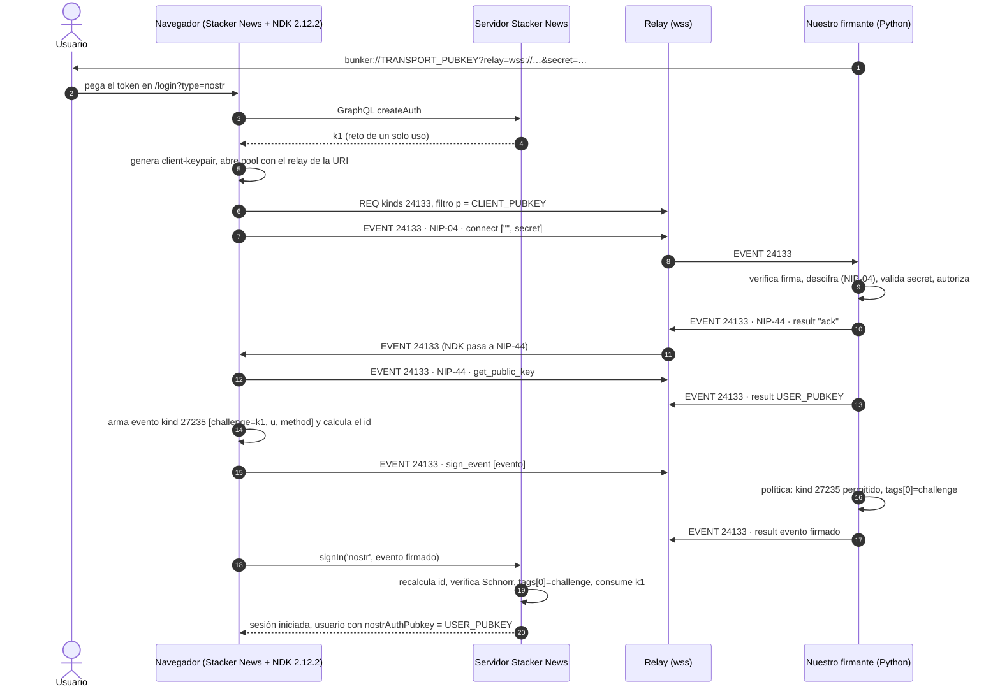

# Compatibilidad NIP-46 con Stacker News

**Fase 0.3: investigación y diseño. Solo lectura de código; no se ejecutó nada contra Stacker News ni contra relays.**
Fecha de consulta: **2026-11-20 (UTC)**. Etiquetas **[V]** verificado, **[I]** inferencia, **[H]** hipótesis pendiente, **[D]** decisión propuesta (ver [nip46-protocol-analysis.md](nip46-protocol-analysis.md) §0). Documentos relacionados: [nip46-security-design.md](nip46-security-design.md), [nip46-implementation-plan.md](nip46-implementation-plan.md).

> **Principio:** cumplir NIP-46 «en general» **no garantiza** compatibilidad con Stacker News. El cliente real es una aplicación web que usa NDK, y NDK se aparta de la especificación vigente en puntos que afectan a un firmante nuevo.

## 1. Fuentes y versiones examinadas

| Fuente | Versión | Cómo se examinó |
|---|---|---|
| [stackernews/stacker.news](https://github.com/stackernews/stacker.news) | `master` @ `0a798c721dd4b75c2451a1a390d8a5b7fdac475c` (2026-11-12, «bump nodejs») | Clonado superficial; lectura de código. **No se ejecutó nada del repositorio.** |
| `@nostr-dev-kit/ndk` | **2.12.2**, la versión fijada en el `package-lock.json` de Stacker News (`package.json` declara `^2.12.2`) | Paquete descargado de npm. Su hash **sha512 coincide** con el `integrity` del lockfile [V]. Se leyó `src/` incluido en el paquete. SHA-256 del `.tgz`: `956abb3c32515cb8b0fa07bdefc8aeb6831e547f9f2cb8d200963f381d974c9e` |
| nsec.app ([nostrband/noauth](https://github.com/nostrband/noauth)) | `main` @ `4d3f9a12ed036f6fea6965fc8a303c779ea1bd16` (2025-05-26) | Lectura de `packages/backend/src/nip46.ts` |
| nsecBunker ([kind-0/nsecbunkerd](https://github.com/kind-0/nsecbunkerd)) | `master` | La rama solo contiene un `README.md` de 15 bytes («Gigi was right»); **no hay código** [V] |

**Límite importante [H]:** se examinó el código de la rama `master` de Stacker News, **no** el despliegue de producción. Si producción va por detrás de `master` o usa otra versión de NDK, el comportamiento podría diferir. Se comprueba en la prueba real (ver [nip46-implementation-plan.md](nip46-implementation-plan.md) §6).

## 2. Resumen ejecutivo

1. Stacker News **solo acepta `bunker://…` o una dirección NIP-05** en el formulario de login con token. **No existe `nostrconnect://`** en su código [V].
2. El cliente corre **en el navegador del usuario** con NDK 2.12.2; se conecta a los relays de la URI desde el navegador [V]. La CSP de producción solo permite `wss:`/`https:` [V], lo que descarta un relay local `ws://`.
3. **NDK 2.12.2 arranca con NIP-04**, no con NIP-44, y cambia de esquema por **detección de formato** de lo que recibe [V, §3.5]. Un firmante «solo NIP-44» no podría ni siquiera descifrar el primer `connect` [I]. Que una respuesta NIP-44 a esa solicitud NIP-04 funcione de extremo a extremo **no está validado**: la ruta de código existe [V], pero falta evidencia experimental (§3.5, experimentos E1 a E6).
4. El flujo del cliente usa **tres métodos**: `connect`, `get_public_key`, `sign_event` [V]. No usa `ping`, `switch_relays` ni `logout` [V].
5. Stacker News firma un evento **`kind 27235`** (NIP-98) con una etiqueta `challenge` **en primera posición** y el servidor valida `id`, firma Schnorr y esa etiqueta; la identidad es `event.pubkey` [V].
6. **Flujo prioritario recomendado: `bunker://`** (único soportado por la interfaz).

## 3. Hallazgos verificados

Todas las rutas son relativas a la raíz del repositorio de Stacker News; los números de línea corresponden al commit indicado.

### 3.1 Cliente de Stacker News

| # | Hallazgo | Evidencia |
|---|---|---|
| S1 | El login Nostr está en `/login?type=nostr`. | `components/login.js:110-111` |
| S2 | El formulario acepta un campo con placeholder `bunker://... or NIP-05 address` y un botón de extensión NIP-07. No hay QR ni generación de URI. | `components/nostr-auth.js:209-233` (placeholder en `:225`) |
| S3 | Antes de firmar, pide un reto al servidor (`createAuth` → `k1`). | `components/nostr-auth.js:75-84, 124-128`; servidor: `api/resolvers/lnurl.js:23-25` |
| S4 | Crea el firmante con `nostr.getSigner({nip46token, …})` y espera `blockUntilReady()`. Sin timeout propio; tras 10 s solo muestra una sugerencia («use a fresh token»). | `components/nostr-auth.js:130-139, 97-106` |
| S5 | Si recibe el evento `authUrl`, valida que sea `http(s)` y muestra el botón «open signer» que abre la URL en otra pestaña. | `components/nostr-auth.js:18-26, 50-73, 134-136` |
| S6 | Firma un evento con **kind 27235**, `created_at` actual, **tags `[["challenge", k1], ["u", NEXT_PUBLIC_URL], ["method","GET"]]`** y **content `"Stacker News Authentication"`**. | `components/nostr-auth.js:148-157` |
| S7 | Envía el evento a `signIn('nostr', {event: JSON.stringify(signedEvent)})` (next-auth). | `components/nostr-auth.js:159-163` |
| S8 | Cambia `bunker://` por `http://` antes de pasarlo a NDK (parche por un problema de parseo de URL de NDK). | `lib/nostr.js:196-202` |
| S9 | La interfaz lista como firmantes NIP-46 compatibles **nsec.app** y **nsecBunker**. | `components/nostr-auth.js:296-316` |
| S10 | La CSP de producción: `connect-src 'self' https: wss:` más `upgrade-insecure-requests`. Un `ws://` solo se admite en desarrollo. | `proxy.js:205-241` (`:230`, `:236`) |

### 3.2 Verificación en el servidor de Stacker News

| # | Hallazgo | Evidencia |
|---|---|---|
| V1 | Proveedor de credenciales `nostr`: `authorize` llama a `nostrEventAuth(event)` y luego a `pubkeyAuth`. | `pages/api/auth/[...nextauth].js:285-295` |
| V2 | `nostrEventAuth` **recalcula el `id`** (SHA-256 de `[0, pubkey, created_at, kind, tags, content]`) y exige que coincida. | `:241-253` |
| V3 | Verifica la firma con `schnorr.verify(sig, id, pubkey)` (`@noble/curves`). | `:255-258` (import en `:11`) |
| V4 | Exige que **`tags[0]` sea `["challenge", <k1>]`** (longitud 2). Si el orden cambia, falla. | `:260-263` |
| V5 | Guarda `pubkey` en la fila `LnAuth` del `k1`; `pubkeyAuth` **borra el reto tras un uso** (anti-repetición) y compara la clave. | `:265-269`, `:196-210` |
| V6 | Si la clave no existe, **crea un usuario** con `name = pubkey.slice(0,10)` y `nostrAuthPubkey = pubkey`; si ya hay sesión, enlaza la clave a ese usuario. | `:212-230` |
| V7 | **En esta ruta no se comprueban** `kind`, `content`, `created_at`, `u` ni `method`. | `:241-270` (ausencia de código) |
| V8 | `User.nostrAuthPubkey` es único; `LnAuth` tiene `createdAt` pero esta ruta no valida caducidad. | `prisma/schema.prisma:64, 370-376` |

**Inferencia [I]:** como el servidor no valida el `kind`, un firmante que firmara «cualquier cosa con `challenge` primero» sería aceptado. Nuestro firmante **no debe** aprovechar eso: solo debe firmar lo que su política autorice (ver [nip46-security-design.md](nip46-security-design.md)).

### 3.3 Comportamiento de NDK 2.12.2 como cliente NIP-46

Rutas relativas al paquete `@nostr-dev-kit/ndk@2.12.2`, carpeta `src/`.

| # | Hallazgo | Evidencia |
|---|---|---|
| N1 | Acepta tokens que empiezan por `bunker://`; si no, trata el texto como NIP-05. De la URL toma el **host como clave del firmante**, `relay` (todos), `secret` y el parámetro **no estándar** `pubkey`. | `signers/nip46/index.ts:83-87, 98-109` |
| N2 | Crea un `client-keypair` aleatorio (`NDKPrivateKeySigner.generate()`) si no se le da uno. | `:89-93` |
| N3 | Abre un pool **propio** con los relays de la URI, con política NIP-42 `signIn` en cada relay. | `signers/nip46/rpc.ts:45-64` (`:60`) |
| N4 | Se suscribe con `{kinds:[24133], "#p":[client-pubkey]}` **sin `since`** y espera EOSE antes de enviar. | `index.ts:125-136`, `rpc.ts:72-105` |
| N5 | `connect` envía **`[userPubkey ?? "", secret?]`**. Con `bunker://` normal, `params[0]` es una **cadena vacía**, no la clave del firmante. No envía permisos ni metadatos. | `index.ts:171-176` |
| N6 | Solo considera exitosa la conexión si **`result === "ack"`**; si no, rechaza con `response.error`. | `index.ts:178-193` |
| N7 | Tras `ack` llama a **`get_public_key`** y toma `response.result` como identidad **sin comprobar `error`**. | `index.ts:184-189, 198-214` |
| N8 | **`encryptionType` por defecto = `"nip04"`**; la solicitud se cifra con ese esquema. | `rpc.ts:37, 206` |
| N9 | Al recibir un evento: si el contenido **no** contiene `?iv=` cambia a `nip44`; si falla, prueba el otro esquema. Por tanto **adopta el esquema de la respuesta**. | `rpc.ts:107-129` |
| N10 | `sign_event` envía `[JSON.stringify(evento)]` con el evento «crudo» (`created_at, content, tags, kind, pubkey, id, sig`). Usa **solo `json.sig`** de la respuesta. | `index.ts:256-277`; `events/index.ts:132-142` |
| N11 | El `id` del evento lo calcula **NDK localmente** (`getEventHash`) con la clave de `get_public_key` antes de pedir la firma. | `events/index.ts:291-314, 429-443` |
| N12 | Si la respuesta trae `result:"auth_url"`, emite `authUrl` con `error` como URL y **vuelve a escuchar con el mismo `id`**. | `rpc.ts:186-197` |
| N13 | La promesa de cada solicitud **nunca se rechaza por timeout**. | `rpc.ts:175-211` |
| N14 | **No implementa** `ping`, `switch_relays` ni `logout` como cliente (búsqueda en todo `src/` sin hallazgos; `ping` solo existe en el backend de ejemplo). | búsqueda en `src/` |
| N15 | Con NIP-05 (`usuario@dominio`): lee `/.well-known/nostr.json`, toma `nip46` como relays y **usa la clave del usuario como clave del firmante**. | `user/index.ts:172-190`; `index.ts:147-163` |
| N16 | El firmante local soporta `nip04` y `nip44` (vía `nostr-tools`). | `signers/private-key/index.ts:72-102` |

### 3.4 Comportamiento de nsec.app (referencia)

| # | Hallazgo | Evidencia (`nostrband/noauth@4d3f9a12`) |
|---|---|---|
| R1 | Detecta NIP-04 por `isNip04(event.content)` y descifra con NIP-04 o NIP-44 según corresponda. | `packages/backend/src/nip46.ts:245-251` |
| R2 | **Siempre responde con NIP-44** (`encryptNip44`), aunque la solicitud fuera NIP-04. | `nip46.ts:301-326` (`:323`) |
| R3 | `connect` devuelve el `secret` si existe y, si no, `"ack"`. | `nip46.ts:29-39` |
| R4 | Valida la firma del evento de solicitud antes de procesar. | `nip46.ts:261-279` |
| R5 | Usa `auth_url` para pedir aprobación humana. | `nip46.ts:328-335` |
| R6 | TTL de los tokens de conexión: 10 minutos. | `packages/backend/src/const.ts` (`TOKEN_TTL`) |

**[I]** R1+R2+N9 son coherentes entre sí: nsec.app responde NIP-44 y NDK adapta su esquema al recibirlo. Esa combinación es la que, presumiblemente, funciona hoy entre Stacker News y nsec.app. **No se ha observado en ejecución [H].**

### 3.5 Revisión final: cómo decide NDK el cifrado (NIP-04 frente a NIP-44)

**Fuente y alcance.** `@nostr-dev-kit/ndk@2.12.2` (hash verificado contra el lockfile de Stacker News). Se leyó el código fuente (`src/`) **y** el código compilado que ejecuta el navegador, `dist/index.mjs` (campo `module` de su `package.json`, línea 12). **El comportamiento de `dist/` coincide con el de `src/`** en todas las líneas citadas. Todo se hizo por lectura; **no se ejecutó nada**.

**Referencias exactas** (rutas dentro del paquete; entre paréntesis, la línea equivalente en `dist/index.mjs`):

| Qué | Dónde |
|---|---|
| El estado `encryptionType` **empieza en `"nip04"`** (valor fijo en código) | `src/signers/nip46/rpc.ts:37` (`dist:7287`) |
| Cada **solicitud** se cifra con el esquema que tenga `encryptionType` en ese momento | `rpc.ts:206` (`dist:7423`); en `sendResponse`, `rpc.ts:162` (`dist:7389`) |
| El firmante local cifra con NIP-44 **solo si** `scheme == "nip44"`; en cualquier otro caso, NIP-04 | `src/signers/private-key/index.ts:79-89` (`dist:7256-7266`) |
| El firmante local descifra igual: NIP-44 solo si se le pide `"nip44"`; si no, NIP-04 | `private-key/index.ts:92-102` (`dist:7267-7277`) |
| **Detección por formato en cada evento recibido:** si el esquema actual es NIP-04 y el contenido **no** incluye `?iv=`, pasa a NIP-44; si es NIP-44 y sí lo incluye, vuelve a NIP-04. El cambio ocurre **antes** de descifrar | `rpc.ts:107-113` (`dist:7349-7353`) |
| Descifra con el esquema actual; si **lanza excepción**, lo reintenta con el otro y, si funciona, fija ese esquema | `rpc.ts:119-129` (`dist:7357-7367`) |
| Un comentario de los autores indica la intención: «support both nip04 and nip44 encryption» | `rpc.ts:108` |
| `encryptionEnabled()` devuelve `["nip04","nip44"]`, pero **`rpc.ts` no lo consulta** | `nip46/index.ts:216-219`; búsqueda en `rpc.ts` sin coincidencias |
| El `connect` inicial se envía **por esa misma instancia** `rpc`, que luego reutilizan `get_public_key` y `sign_event` | `nip46/index.ts:95, 178, 204, 260` |
| Parámetros de `connect` y verificación de `ack` | `index.ts:171-176, 184` (`dist:7805-7814`) |

**Máquina de estados de NDK, resumida:**

| Paso | `encryptionType` | Qué ocurre |
|---|---|---|
| 1 | `nip04` (por defecto) | `connect` sale cifrado con **NIP-04**. |
| 2 | `nip04` | Llega la respuesta del firmante. Si su `content` **no** contiene `?iv=` (es NIP-44), `encryptionType` pasa a `nip44` y se descifra con NIP-44. Si sí lo contiene, sigue en `nip04`. |
| 3 | `nip44` (o `nip04`) | Si el descifrado lanza error, se prueba con el otro esquema. |
| 4 | el último fijado | `get_public_key` y `sign_event` salen con ese esquema. |

**Conclusiones y su grado de certeza:**

| # | Conclusión | Clasificación |
|---|---|---|
| E-1 | NDK selecciona **NIP-04 para la solicitud inicial** (`connect`). | **Verificada en código** (`rpc.ts:37, 206`; `dist:7287, 7423`) |
| E-2 | La decisión del cifrado de cada respuesta es **detección de formato** (`?iv=`) sobre un **valor inicial fijo** y con **reintento con el otro esquema** si falla. **No** hay negociación ni configuración previa del firmante. | **Verificada en código** (`rpc.ts:107-129`; `dist:7349-7367`) |
| E-3 | Las solicitudes posteriores usan el esquema que se fijó con la última respuesta. | **Verificada en código** (`rpc.ts:206`) |
| E-4 | Una **respuesta NIP-44 a una solicitud NIP-04 entra en una ruta de código que la procesa** (cambia a `nip44` y descifra con `nip44.v2.decrypt`). | **Verificada en código** (la ruta existe en el `dist` que se publica) |
| E-5 | Esa ruta **funciona de extremo a extremo con nuestro firmante**. | **Inferida; sin evidencia concluyente.** Falta confirmar: (a) la implementación NIP-44 concreta del navegador (`nostr-tools`, versión **2.16.2** según el lockfile, **no leída**: la descarga no se realizó); (b) que nuestra carga sea aceptada por ella; (c) que el despliegue de Stacker News use este NDK; (d) el orden de eventos asíncronos. |
| E-6 | Un firmante **solo NIP-44** no podría descifrar el `connect` inicial. | **Inferida** de E-1 (consecuencia lógica; no probada) |
| E-7 | El modo «espejo» (responder en el esquema de la solicitud) mantiene a NDK en NIP-04 y **evita la ruta de cambio**. | **Verificada en código** (`rpc.ts:109-113`: sin cambio cuando el esquema coincide) |
| E-8 | nsec.app, que Stacker News lista como compatible, **responde siempre en NIP-44** (`nip46.ts:301-326`), lo que sugiere que la combinación «solicitud NIP-04 / respuesta NIP-44» se usa en la práctica. | **Verificada en código** (comportamiento de nsec.app); que funcione en producción es **inferido** |
| E-9 | Un firmante que **mezcle** esquemas hace que NDK cambie de estado en cada evento. | **Verificada en código** (`rpc.ts:109-113`) |

**Veredicto:** hay evidencia de que la ruta existe y de que otro firmante la usa, pero **no hay evidencia concluyente de que funcione de extremo a extremo**. La incertidumbre se conserva y se resuelve con los experimentos siguientes.

**Experimentos específicos para la Fase 1.0 (tarea T11) [D]:**

Requisitos: aprobación explícita para **ejecutar código de terceros** (NDK 2.12.2 y `nostr-tools` 2.16.2 con los hashes del lockfile de Stacker News) y para instalar Node y un relay **local**; claves de juguete; sin Stacker News y sin relays públicos.

| # | Experimento | Criterio de éxito |
|---|---|---|
| E1 | El firmante responde **NIP-44** al `connect` NIP-04 de un `NDKNip46Signer` real contra un relay local | `blockUntilReady()` se resuelve con la clave de identidad del firmante |
| E2 | Tras E1, observar el esquema de las solicitudes siguientes y completar `sign_event` con un evento `kind 27235` con la forma exacta de Stacker News | Las solicitudes llegan en NIP-44; la firma devuelta verifica sin conexión sobre el `id` calculado por NDK |
| E3 | Descifrar en Python el primer `connect` NIP-04 real de NDK | Texto plano idéntico al esperado; sin errores de relleno |
| E4 | Modo espejo: el firmante responde **NIP-04** a todo | El flujo completo termina igual que en E1/E2 |
| E5 | Interoperabilidad NIP-44 cruzada: `nostr-tools` cifra y Python descifra, y al revés; mensajes de varios tamaños (1, 32, 33, 1000 bytes, Unicode) | Resultados idénticos en ambos sentidos |
| E6 | Orden y carrera: respuestas consecutivas rápidas (`ack` y luego la clave pública) | Sin oscilaciones de esquema ni bloqueos |

**Regla de decisión:** si E1 y E2 pasan, se mantiene NIP-44 como respuesta por defecto. Si fallan y E4 pasa, el valor por defecto pasa a **espejo** para clientes que inicien en NIP-04. Si ambos fallan, es un **bloqueo** que se informa al propietario. Hasta entonces, el valor por defecto de la respuesta es **provisional**.

## 4. Diferencias entre la especificación y el cliente real

| Tema | NIP-46 vigente | Cliente real (NDK 2.12.2) | Consecuencia para el firmante |
|---|---|---|---|
| Cifrado de transporte | NIP-44 | Arranca en **NIP-04**; luego adopta el de la respuesta | **Aceptar NIP-04 entrante.** Responder en NIP-44 (como nsec.app) o espejar. |
| `connect.params[0]` | Clave del firmante | `""` (o `?pubkey=` de la URI) | **No validar** estrictamente. |
| `connect` permisos/metadatos | Opcionales | No los envía | Los permisos **no** vienen del cliente: los define el firmante. |
| `switch_relays` | Los clientes «deberían» enviarlo al conectar | No lo envía | Mantener los relays de la URI; implementarlo con `null` por compatibilidad futura. |
| `logout` / `ping` | Existen | No los envía | Opcionales. |
| Resultado de `sign_event` | Evento firmado completo | Solo usa `.sig` | **No alterar ningún campo** del evento. |
| Reto `auth_url` | Opcional | Soportado y mostrado en la UI | Aprobación humana posible. |
| Login NIP-05 | **Eliminado** de la spec | Soportado | Fuera de la primera demostración. |
| `since` en la suscripción | No definido | Sin `since` | El firmante debe tolerar reproducciones y entregas duplicadas. |
| Errores | `error` es texto libre | Para `get_public_key` no comprueba `error` | Una falla en `get_public_key` puede dejar al cliente con `undefined`: no responder con error en ese método a clientes autorizados. |

## 5. Flujo de autenticación observado (cliente real + servidor)

Qué respalda cada parte del diagrama: los pasos del lado de Stacker News y NDK (2-8, 11-12, 14-15 y 18-20) están **verificados** por el código leído (§3.1-3.3). Los pasos 9-10, 13 y 16-17 son el comportamiento que **debe implementar nuestro firmante**. Que NDK acepte efectivamente una respuesta NIP-44 a una solicitud NIP-04 (pasos 10-11) está **inferido** de N9 y del comportamiento de nsec.app **[H]**.

## 6. Requisitos concretos que debe cumplir nuestro firmante

| # | Requisito | Base |
|---|---|---|
| C1 | La URI `bunker://<transport-pubkey>?relay=wss://…&secret=…` lleva **al menos un `relay` `wss://`**, la clave en minúsculas y un `secret` sin caracteres problemáticos. Sin `relay`, NDK abre un pool vacío y no funciona. | N1, N3, S10 |
| C2 | El firmante está **suscrito antes** de que el usuario pegue la URI: los eventos `24133` son efímeros. | NIP-01; N4 |
| C3 | Descifra **NIP-04 y NIP-44** (detección por `?iv=`). | N8, N9, R1 |
| C4 | `connect`: acepta `params[0]` vacío; valida y consume `params[1]`; responde `result: "ack"` exactamente. | N5, N6 |
| C5 | `get_public_key` devuelve la clave de **identidad** (hex minúsculas, 64 caracteres), sin `error`. | N7 |
| C6 | `sign_event`: recibe el evento crudo, **ignora** `id`/`pubkey`/`sig`, fija la clave de identidad, recalcula el `id` (NIP-01) y firma. El `sig` debe ser válido sobre el `id` que calculó NDK. **No cambia `created_at`, `tags` ni `content`.** | N10, N11 |
| C7 | El resultado de `sign_event` es el evento firmado completo como string JSON. | NIP-46; N10 |
| C8 | El **orden de las etiquetas se conserva**: `["challenge", k1]` primero. | V4 |
| C9 | Cada respuesta es un evento `kind 24133` firmado por la **clave de transporte**, con `p` = clave del cliente, publicado en los relays de la conexión. | NIP-46 |
| C10 | **Esquema de respuesta [D, provisional]:** NIP-44 por defecto (como nsec.app), con un ajuste de configuración para **espejar el esquema de la solicitud**. El valor por defecto definitivo se decide tras los experimentos E1, E2 y E4 (§3.5). | R2, E-2, E-4, E-7 |
| C11 | Sin tiempos de espera del lado del cliente: la aprobación humana puede tardar. El **firmante** aplica sus propios límites (TTL del secreto, ventanas). | N13 |
| C12 | Soporte NIP-42 en el cliente de relay del firmante (si el relay elegido lo exige). | NIP-42 |

## 7. Elección del flujo para la primera prueba real

| Criterio | `bunker://` | `nostrconnect://` |
|---|---|---|
| ¿Lo ofrece la interfaz de Stacker News? | **Sí** (S2) | **No** (sin cadena `nostrconnect` en todo el repositorio) |
| Complejidad para el firmante | Baja: genera una URI y responde a solicitudes | Media: además debe iniciar la respuesta `connect` con el secreto |
| Complejidad para el usuario | Copiar y pegar un token | No aplicable |
| Riesgo de suplantación | Mitigado con secreto de un solo uso + aprobación | No aplicable |

**[D] Recomendación: priorizar `bunker://`.** `nostrconnect://` puede implementarse después como mejora, pero **no sirve para Stacker News** con el código actual. El login por NIP-05 queda descartado para la primera demostración (exige servir `/.well-known/nostr.json` por HTTPS en un dominio propio) [I].

## 8. Hipótesis pendientes y cómo comprobarlas

| # | Hipótesis | Cómo comprobarla |
|---|---|---|
| H1 | Producción de Stacker News ejecuta una versión equivalente a `master` y NDK 2.12.x. | Observando el comportamiento en la prueba real (qué cifrado llega en `connect`). No se consulta el sitio durante esta fase. |
| H2 | NDK procesa de extremo a extremo una respuesta NIP-44 a una solicitud NIP-04. (La **ruta de código existe**: E-4; que funcione está **sin validar**: E-5.) | Experimentos E1 a E6 de §3.5, en laboratorio (Fase 1.0, T11). Contingencia: modo espejo NIP-04 (E4). |
| H3 | Un relay público concreto acepta `kind 24133` sin NIP-42 y reenvía eventos efímeros con prontitud. | Observación controlada con autorización de conexión (ver plan). |
| H4 | El navegador del usuario puede abrir `wss://` al relay elegido desde `stacker.news` (sin bloqueos de extensiones ni CSP). | CSP verificada [V]; resto, en la prueba real. |
| H5 | Todos los pasos del §5 se completan sin intervención adicional. | Prueba real. |
| H6 | Un `k1` no usado no caduca en el servidor en una ventana razonable. | La ruta leída no valida caducidad [V], pero puede haber una tarea de limpieza. Comprobar en la prueba real con el tiempo de aprobación. |

## 9. Riesgos de compatibilidad

| Riesgo | Prioridad | Mitigación propuesta |
|---|---|---|
| NIP-04 inevitable para Stacker News (divergencia con la spec) | **Alta** | Aceptarlo de forma acotada, configurable y registrada; ver diseño de seguridad. |
| Cliente cambia de NDK a una versión que solo usa NIP-44 | Media | Soportar ambos y probar con la versión vigente al momento de la prueba. |
| `nsecBunker` sin código público (S9 lo lista) | Baja | No tomarlo como referencia; usar nsec.app y la spec. |
| Relay inadecuado (AUTH, límites, latencia) | Media | Elección y verificación previas con autorización; plan con un relay primario y uno de reserva. |
| Cambios futuros en Stacker News | Media | Anotar el commit y la fecha de cada prueba; repetir la lectura de código antes de cada demostración. |
